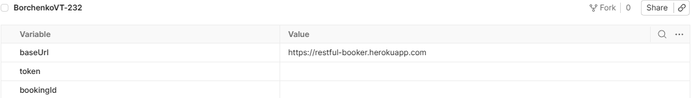
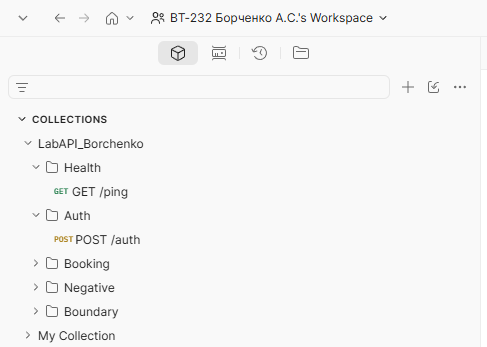
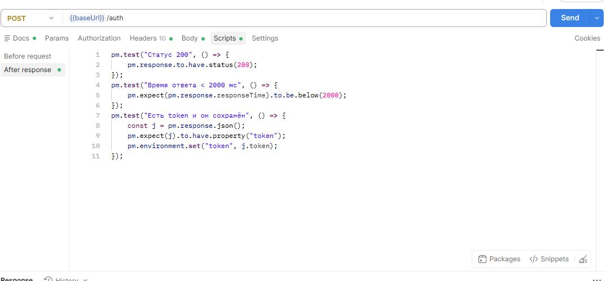
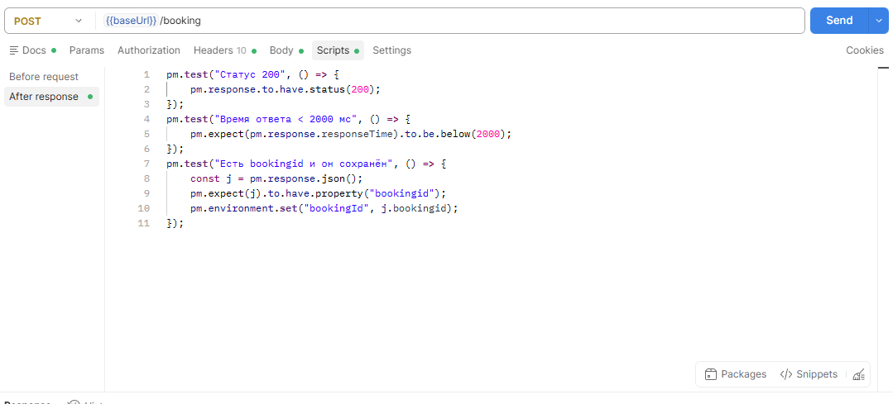
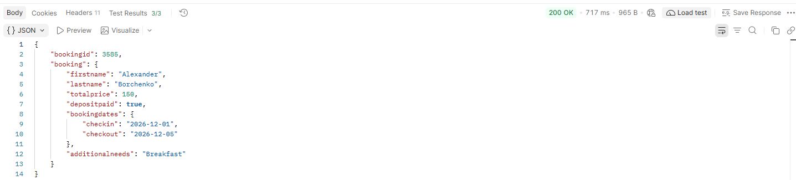
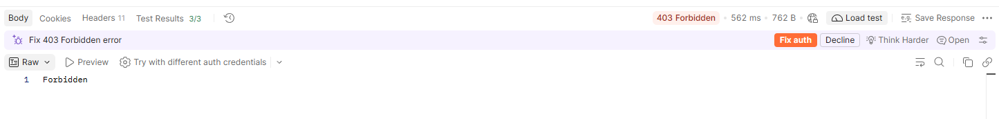
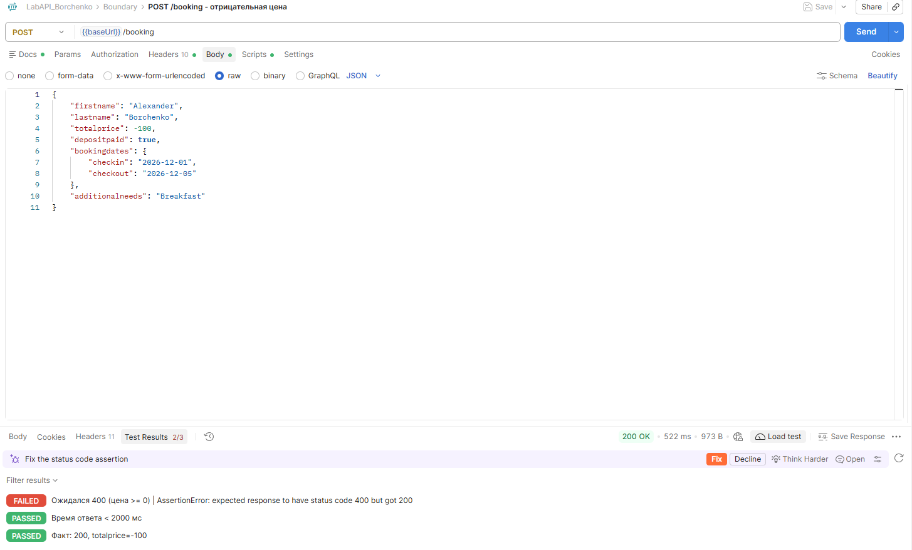
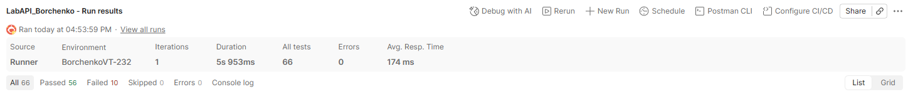
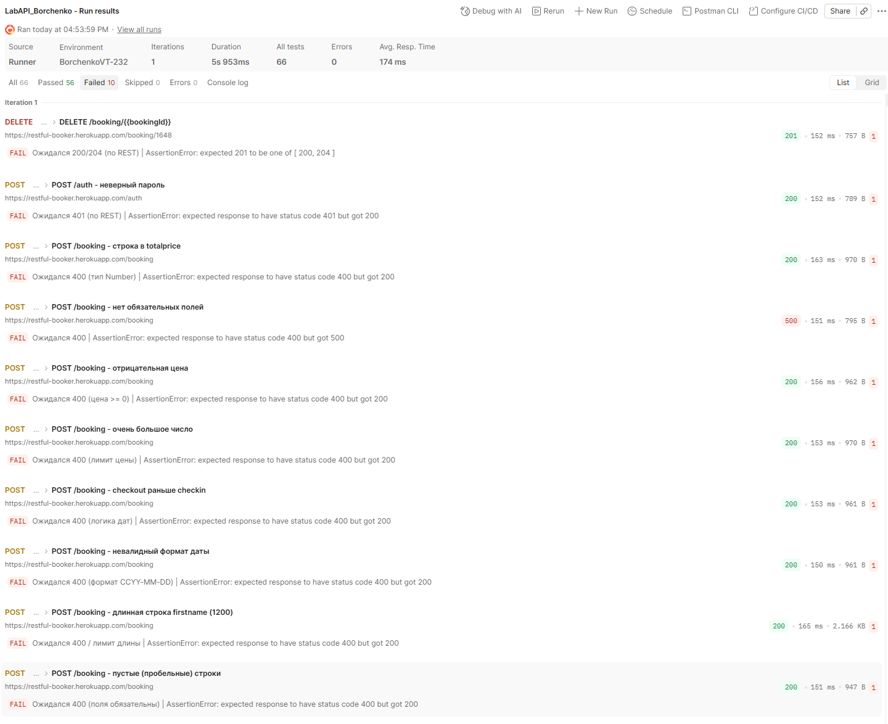

# Лабораторная работа № 3 «Интеграционное и API-тестирование»

## 1. Цель и задачи

Освоить тестирование REST API на открытом учебном сервисе: построить коллекцию запросов в Postman,
написать автоматические проверки и проанализировать расхождения между документацией, семантикой REST
и фактическим поведением API.

Выполнено:
1. Коллекция `LabAPI_Borchenko` с папками по ресурсам `Auth`, `Booking`, `Health`
   (негативные и граничные кейсы ресурса Booking вынесены в подпапки `Negative`, `Boundary`).
2. Запросы ко всем 8 эндпоинтам; у каждого запроса в Postman заполнено описание
   (цель / входные данные / ожидаемый результат).
3. Автоматическая передача данных: токен и `bookingid` сохраняются скриптами Tests в окружение.
4. Тест-кейсы трёх категорий: позитивные (включая полную цепочку с повторным GET → 404),
   негативные, граничные (в т.ч. строка 1200 символов и цена 999999999999).
5. Ровно 3 автоматические проверки на запрос: статус-код, время ответа, тело/структура.
6. Прогон всей коллекции через Collection Runner без ручного вмешательства.
7. Таблица расхождений и баг-репорты по найденным дефектам.

## 2. Тестируемая система

Restful-Booker - учебное API бронирования отелей: `https://restful-booker.herokuapp.com`
(документация: `/apidoc/index.html`).

| Метод | Эндпоинт | Назначение | Авторизация |
|---|---|---|---|
| POST | `/auth` | получение токена (admin / password123) | - |
| GET | `/booking` | список id бронирований (с фильтрами) | - |
| GET | `/booking/{id}` | получение бронирования | - |
| POST | `/booking` | создание бронирования | - |
| PUT | `/booking/{id}` | полное обновление | Cookie: token=… |
| PATCH | `/booking/{id}` | частичное обновление | Cookie: token=… |
| DELETE | `/booking/{id}` | удаление | Cookie: token=… |
| GET | `/ping` | проверка работоспособности | - |

## 3. Организация тестирования

### 3.1 Окружение `Restful-Booker Env`

| Переменная | Начальное значение | Заполняется |
|---|---|---|
| `baseUrl` | https://restful-booker.herokuapp.com | вручную |
| `token` | (пусто) | скриптом Tests в POST /auth |
| `bookingId` | (пусто) | скриптом Tests в POST /booking |

Экспорт окружения (`Restful-Booker_Env.postman_environment.json`):

```json
{
  "name": "Restful-Booker Env",
  "values": [
    { "key": "baseUrl", "value": "https://restful-booker.herokuapp.com", "enabled": true },
    { "key": "token", "value": "", "enabled": true },
    { "key": "bookingId", "value": "", "enabled": true }
  ],
  "_postman_variable_scope": "environment"
}
```


*Рисунок 1. Переменные окружения*

### 3.2 Структура коллекции: 5 папок, 22 запроса, 66 проверок

```
LabAPI_Borchenko
├── Health   (1): GET /ping
├── Auth     (1): POST /auth
├── Booking  (7): GET список → POST создание → GET по id → PUT → PATCH → DELETE → GET после удаления (404)
├── Negative (6): неверный пароль; PUT без токена; PUT с неверным токеном;
│                 некорректный JSON; строка в totalprice; отсутствие обязательных полей
└── Boundary (7): цена 0; цена −100; цена 999999999999; checkout раньше checkin;
                  невалидный формат даты; firstname 1200 символов; пробельные строки
```

Кейс «несуществующий id» покрыт запросом `GET /booking/{{bookingId}} - после удаления`:
удалённый идентификатор гарантированно отсутствует, ответ 404 проверяется явно.



*Рисунок 2. Папки и запросы коллекции LabAPI_Borchenko*

### 3.3 Автоматизация передачи данных

Сохранение токена (Tests в `POST /auth`):

```javascript
pm.test("Есть token и он сохранён", () => {
    const j = pm.response.json();
    pm.expect(j).to.have.property("token");
    pm.environment.set("token", j.token);
});
```

Сохранение id (Tests в `POST /booking`):

```javascript
pm.test("Есть bookingid и он сохранён", () => {
    const j = pm.response.json();
    pm.expect(j).to.have.property("bookingid");
    pm.environment.set("bookingId", j.bookingid);
});
```



*Рисунок 3. Сохранение токена во вкладке Tests*



*Рисунок 4. Сохранение bookingId*

Защищённые запросы используют `Cookie: token={{token}}` и URL `{{baseUrl}}/booking/{{bookingId}}`.
Порядок папок гарантирует: токен получен до авторизованных операций, id создан до его использования.
Негативные PUT выполняются после удаления брони - это корректно: проверка авторизации на сервере
выполняется раньше проверки существования id, поэтому ответ 403 не зависит от судьбы брони.

### 3.4 Методика проверок

Каждый запрос содержит ровно 3 проверки: **ожидаемый статус-код**, **время ответа < 2000 мс**,
**содержимое тела**. Статус-ассерты намеренно кодируют *правильное* поведение по REST/документации
(401 при неверных credentials, 400 при невалидных данных, 200/204 при удалении). Поэтому:

- проверка прошла → поведение соответствует ожиданиям;
- проверка упала → зафиксировано расхождение, которое оформляется как дефект (разделы 6-7).

В «дефектных» запросах третья проверка фиксирует фактический ответ и проходит -
она документирует, что именно вернул сервер. Такой дизайн исключает путаницу
«дефект продукта vs дефект теста»: все падения в прогоне - дефекты продукта.

## 4. Таблица тест-кейсов

«Ожидаемый» - по REST/документации; «Фактический» - ответ стенда.
Y - все 3 проверки пройдены; N - есть упавшая проверка (дефект).

| ID | Запрос | Тип | Входные данные                                               | Ожидаемый | Фактический | Статус |
|---|---|---|--------------------------------------------------------------|---|---|---|
| TC-01 | GET /ping | позит. | -                                                            | 200 (REST); 201 по док. | 201, «Created» | Y (особенность D-13) |
| TC-02 | POST /auth | позит. | admin / password123                                          | 200 + token | 200, token сохранён | Y |
| TC-03 | GET /booking | позит. | -                                                            | 200, массив | 200, массив id | Y |
| TC-04 | POST /booking | позит. | Alexander/Borchenko, 150, true, 2026-12-01→12-05, Breakfast  | 201 (REST); 200 по док. | 200, bookingid сохранён | Y (особенность D-02) |
| TC-05 | GET /booking/{{bookingId}} | позит. | id из TC-04                                                  | 200 + данные | 200, firstname=Alexander | Y |
| TC-06 | PUT /booking/{{bookingId}} | позит. | токен; AlexanderUpdated, 250, false, 2027-01-10→01-15, Lunch | 200 + новые данные | 200, totalprice=250 | Y |
| TC-07 | PATCH /booking/{{bookingId}} | позит. | токен; `{"firstname":"AlexanderPatched"}`                    | 200, частичное обновление | 200, firstname обновлён | Y |
| TC-08 | DELETE /booking/{{bookingId}} | позит. | токен                                                        | 200/204 (REST) | 201, «Created» | N → BUG-02 |
| TC-09 | GET /booking/{{bookingId}} после удаления | позит./негат. | удалённый (несуществующий) id                                | 404 | 404, «Not Found» | Y |
| TC-10 | POST /auth - неверный пароль | негат. | admin / wrongpassword                                        | 401, без токена | 200, `{"reason":"Bad credentials"}` | N → BUG-01 |
| TC-11 | PUT - без токена | негат. | валидное тело, без Cookie                                    | 401/403 | 403, «Forbidden» | Y (особенность D-04) |
| TC-12 | PUT - некорректный токен | негат. | token=invalidtoken123                                        | 401/403 | 403, «Forbidden» | Y (особенность D-04) |
| TC-13 | POST /booking - некорректный JSON | негат. | лишняя запятая перед `}`                                     | 400 | 400, «Bad Request» | Y |
| TC-14 | POST /booking - строка в totalprice | негат. | `"totalprice":"сто рублей"`                                  | 400 (тип Number) | 200, `totalprice: null` | N → BUG-03 |
| TC-15 | POST /booking - нет обязательных полей | негат. | только firstname                                             | 400 | 500, «Internal Server Error» | N → BUG-04 |
| TC-16 | POST /booking - totalprice = 0 | гран. | 0                                                            | 200 (нулевая цена допустима) | 200, totalprice=0 | Y (наблюдение D-14) |
| TC-17 | POST /booking - отрицательная цена | гран. | −100                                                         | 400 (цена ≥ 0) | 200, totalprice=−100 | N → BUG-05 |
| TC-18 | POST /booking - очень большое число | гран. | 999999999999                                                 | 400 (лимит) | 200, значение сохранено | N → BUG-05 |
| TC-19 | POST /booking - checkout раньше checkin | гран. | 2026-12-05 → 2026-12-01                                      | 400 (логика дат) | 200, инверсия сохранена | N → BUG-06 |
| TC-20 | POST /booking - невалидный формат даты | гран. | "32-13-2026" / "not-a-date"                                  | 400 (CCYY-MM-DD) | 200, checkin=`"0NaN-aN-aN"` | N → BUG-06 |
| TC-21 | POST /booking - длинная строка | гран. | firstname 1200 символов                                      | 400 / лимит длины | 200, строка целиком | N → BUG-07 |
| TC-22 | POST /booking - пустые строки | гран. | firstname/lastname = " "                                     | 400 (обязательные поля) | 200, пробел сохранён | N → BUG-08 |

**Итог:** 22 запроса, 66 проверок: **56 пройдено, 10 упало**.
Задействованы коды **200, 201, 400, 403, 404, 500**. Код 401 API не возвращает ни в одном сценарии
(зафиксировано как дефект BUG-01); 405 достижим при PUT/DELETE несуществующего id с валидным токеном,
но в лимит 22 запросов не включён.

Скриншоты характерных кейсов:


*Рисунок 5 - Позитив: создание бронирования, bookingid сохранён*


*Рисунок 6 - Негатив: PUT без токена, 403 Forbidden*


*Рисунок 7 - Граница: цена −100 принята (ожидался 400)*

## 5. Прогон через Collection Runner

### 5.1 Сводка

| Показатель | Значение |
|---|---|
| Environment | Restful-Booker Env |
| Iterations / Delay | 1 / 300 мс |
| Запросов | 22 |
| Проверок | **66** |
| Passed | **56** |
| Failed | **10** |
| Skipped / Errors | 0 / 0 |
| Duration | ≈ 6 s |
| Avg. response time | ≈ 170 ms |

Errors = 0: сетевых сбоев не было, все падения - результаты ассертов.
Перед прогоном выполнен одиночный GET /ping («прогрев» Heroku), чтобы первый запрос не дал
ложное падение по времени.


*Рисунок 8 - Итоговая сводка Collection Runner*

### 5.2 Упавшие проверки (вкладка Failed)

| Запрос | Упавшая проверка | Сообщение | Причина |
|---|---|---|---|
| DELETE /booking/{{bookingId}} (201) | Ожидался 200/204 | `expected 201 to be one of [ 200, 204 ]` | BUG-02 |
| POST /auth - неверный пароль (200) | Ожидался 401 | `expected response to have status code 401 but got 200` | BUG-01 |
| POST - строка в totalprice (200) | Ожидался 400 | `…400 but got 200` | BUG-03 |
| POST - нет обязательных полей (500) | Ожидался 400 | `…400 but got 500` | BUG-04 |
| POST - отрицательная цена (200) | Ожидался 400 | `…400 but got 200` | BUG-05 |
| POST - очень большое число (200) | Ожидался 400 | `…400 but got 200` | BUG-05 |
| POST - checkout раньше checkin (200) | Ожидался 400 | `…400 but got 200` | BUG-06 |
| POST - невалидный формат даты (200) | Ожидался 400 | `…400 but got 200` | BUG-06 |
| POST - длинная строка (200) | Ожидался 400 | `…400 but got 200` | BUG-07 |
| POST - пустые строки (200) | Ожидался 400 | `…400 but got 200` | BUG-08 |


*Рисунок 9 - Collection Runner: упавшие проверки*

**Классификация:** все 10 падений - дефекты продукта; ошибок тестовых скриптов нет.

## 6. Таблица расхождений с документацией и REST

| № | Запрос | Ожидалось (REST/док.) | Получено | Вывод |
|---|---|---|---|---|
| D-01 | POST /auth, неверный пароль | 401 Unauthorized | 200 + `{"reason":"Bad credentials"}` | Дефект BUG-01 |
| D-02 | POST /booking, успешное создание | 201 Created (+ Location) | 200 OK | Особенность (соответствует док.) |
| D-03 | DELETE /booking/{id} | 204 / 200 | 201 Created | Дефект BUG-02 (документирован) |
| D-04 | PUT без токена / неверный токен | 401 Unauthorized | 403 Forbidden | Особенность / минорное замечание |
| D-05 | POST /booking, totalprice - строка | 400 (тип Number) | 200, `totalprice: null` | Дефект BUG-03 |
| D-06 | POST /booking, нет обязательных полей | 400 | 500 | Дефект BUG-04 |
| D-07 | POST /booking, цена −100 | 400 (цена ≥ 0) | 200 | Дефект BUG-05 |
| D-08 | POST /booking, цена 999999999999 | 400 (лимит) | 200 | Дефект BUG-05 |
| D-09 | POST /booking, checkout < checkin | 400 (бизнес-правило) | 200 | Дефект BUG-06 |
| D-10 | POST /booking, невалидная дата | 400 (CCYY-MM-DD) | 200, `"0NaN-aN-aN"` | Дефект BUG-06 |
| D-11 | POST /booking, строка 1200 символов | 400 / лимит | 200, без ограничений | Дефект BUG-07 |
| D-12 | POST /booking, пробельные строки | 400 (обязательные поля) | 200, " " сохранён | Дефект BUG-08 |
| D-13 | GET /ping | 200 OK | 201 Created | Особенность (документировано) |
| D-14 | POST /booking, цена 0 | 400 (строгое правило) | 200 | Наблюдение: нулевая цена допустима, дефектом не считаю |

## 7. Баг-репорты

### BUG-01 · /auth маскирует ошибку аутентификации кодом 200 · Critical
- **Шаги:** POST `{{baseUrl}}/auth`, тело `{"username":"admin","password":"wrongpassword"}`.
- **Ожидаемо:** 401 Unauthorized, токен не выдаётся.
- **Фактически:** 200 OK, `{"reason":"Bad credentials"}`.
- **Влияние:** клиент, ориентирующийся на статус-код, считает аутентификацию успешной.

### BUG-02 · Успешный DELETE возвращает 201 Created · Minor
- **Шаги:** получить токен → создать бронь → DELETE `{{baseUrl}}/booking/{{bookingId}}` с `Cookie: token={{token}}`.
- **Ожидаемо:** 204 No Content (или 200 OK).
- **Фактически:** 201 Created, тело «Created» - семантика «создание» при удалении.
- **Примечание:** поведение заявлено в документации, но нарушает REST.

### BUG-03 · Нет валидации типа totalprice: строка превращается в null · Major
- **Шаги:** POST /booking с `"totalprice":"сто рублей"`.
- **Ожидаемо:** 400 Bad Request (по документации тип - Number).
- **Фактически:** 200 OK, бронь создана, в ответе `totalprice: null` - тихая порча данных.

### BUG-04 · Отсутствие обязательных полей → 500 вместо 400 · Major
- **Шаги:** POST /booking с телом `{"firstname":"Alexander"}`.
- **Ожидаемо:** 400 с указанием незаполненных полей.
- **Фактически:** 500 Internal Server Error - ошибка клиента маскируется под сбой сервера.

### BUG-05 · Нет ограничений диапазона цены · Major
- **Шаги:** POST /booking с `totalprice: -100`; повторить с `totalprice: 999999999999`.
- **Ожидаемо:** 400 (цена ≥ 0, разумный верхний предел).
- **Фактически:** 200 OK в обоих случаях, значения сохраняются как есть.

### BUG-06 · Нет валидации дат: порядок и формат · Major
- **Шаги:** POST /booking с checkin 2026-12-05 / checkout 2026-12-01; отдельно - checkin `"32-13-2026"`, checkout `"not-a-date"`.
- **Ожидаемо:** 400 (checkout ≥ checkin; формат CCYY-MM-DD).
- **Фактически:** 200 OK; инвертированный период принимается; невалидная дата возвращается как `"0NaN-aN-aN"` - данные брони повреждены.

### BUG-07 · Нет ограничения длины строковых полей · Minor
- **Шаги:** POST /booking с firstname из 1200 символов (генерируется pre-request скриптом).
- **Ожидаемо:** 400 или обрезка до документированного лимита.
- **Фактически:** 200 OK, строка сохранена целиком.

### BUG-08 · Пробельные строки в обязательных полях принимаются · Major
- **Шаги:** POST /booking с `firstname:" "`, `lastname:" "`.
- **Ожидаемо:** 400 - обязательные поля не могут быть пустыми.
- **Фактически:** 200 OK, бронь без имени гостя создана, пробел сохранён.

**Минорные замечания без отдельных баг-репортов:** 403 вместо 401 (D-04); 200 вместо 201 при
создании (D-02); 201 на /ping (D-13); допустимость нулевой цены (D-14).

## Вывод

В результате выполнения лабораторной работы была построена коллекция `LabAPI_Borchenko` (22 запроса, 5 папок, 66 проверок) с окружением
`Restful-Booker Env` и автоматической передачей токена и id. Полная позитивная цепочка
«создание → получение → PUT → PATCH → удаление → повторное получение (404)» выполняется в
Collection Runner без ручного вмешательства. Прогон: **56/66 проверок пройдено,
10 упало, 0 ошибок**; все падения классифицированы как дефекты продукта и оформлены в
8 баг-репортов и 14 расхождений с REST/документацией. Основные классы проблем: некорректная
семантика кодов (200 при ошибке аутентификации, 500 при ошибках валидации, 201 при удалении)
и отсутствие валидации типов, диапазонов цены, длины строк, пустых значений и дат.
Дополнительно: документация не гарантирует реального поведения API - необходимы
контрактные проверки кодов и ответов, а результаты автотестов нужно классифицировать
на «дефект продукта» и «дефект теста».

---