# Лабораторная работа № 3 «Интеграционное и API-тестирование»

## Цель работы

Освоить тестирование REST API на примере открытого публичного сервиса: научиться строить в Postman коллекцию запросов,
писать автоматические проверки и анализировать расхождения между документацией и фактическим поведением API.

---

**Задачи:**

1. Создайте в Postman коллекцию `LabAPI_<Фамилия>` с переменными окружения (`baseUrl`, `token`, `bookingId`) и папками
   по ресурсам: `Auth`, `Booking`, `Health`.

2. Добавьте запросы **ко всем эндпоинтам** из таблицы. Для каждого запроса напишите описание: цель, входные данные,
   ожидаемый результат.

3. Автоматизируйте получение токена. В запросе `POST /auth` скриптом во вкладке Tests сохраните токен в переменную
   окружения. В запросе создания бронирования сохраните `bookingid`.

4. Составьте и выполните тест-кейсы в каждой категории:

    - **Позитивные**: создание → получение → обновление (PUT и PATCH) → удаление → повторное получение (ожидается 404).
    - **Негативные**: неверный логин или пароль, запрос без токена и с некорректным токеном, несуществующий `id`,
      некорректный JSON, неверный тип данных (например, строка в `totalprice`), отсутствие обязательных полей.
    - **Граничные значения**: пустые строки, очень длинные строки (1000+ символов), `totalprice` = 0, отрицательное и
      очень большое число, дата `checkout` раньше `checkin`, невалидный формат даты.
    - **Коды ответов**: для каждого теста явно укажите ожидаемый код (200, 201, 400, 403/401, 404, 405, 500). По
      возможности вызовите разные коды.

5. Для каждого запроса добавьте во вкладку Tests минимум 3 автоматические проверки, например:

   ```javascript
   pm.test("Статус 200", () => pm.response.to.have.status(200));
   pm.test("Время ответа < 2000 мс", () => pm.expect(pm.response.responseTime).to.be.below(2000));
   pm.test("Есть поле bookingid", () => pm.expect(pm.response.json()).to.have.property("bookingid"));
   ```

6. Запустите всю коллекцию через **Collection Runner** и убедитесь, что цепочка сценариев работает без ручного
   вмешательства (токен и `id` передаются через переменные).

7. **Фактическое и ожидаемое поведение.** Это публичное учебное API, и его реальное поведение может отличаться от
   документации и от «правильного» REST (нестандартные коды для ошибок, код ответа для DELETE и т. д.). Оформите таблицу
   расхождений:

   | № | Запрос | Ожидалось (по REST/документации) | Получено | Вывод (дефект / особенность) |
                  |---|---|---|---|---|

---

## Тестируемая система

**Restful-Booker**, открытое учебное API бронирования отелей: https://restful-booker.herokuapp.com (
документация: https://restful-booker.herokuapp.com/apidoc/index.html). Docker и локальный запуск не нужны, достаточно
Postman и доступа в интернет.

| Метод  | Эндпоинт        | Назначение                                             |
|--------|-----------------|--------------------------------------------------------|
| POST   | `/auth`         | получение токена (логин `admin`, пароль `password123`) |
| GET    | `/booking`      | список идентификаторов бронирований (с фильтрами)      |
| GET    | `/booking/{id}` | получение бронирования                                 |
| POST   | `/booking`      | создание бронирования                                  |
| PUT    | `/booking/{id}` | полное обновление (нужна авторизация)                  |
| PATCH  | `/booking/{id}` | частичное обновление (нужна авторизация)               |
| DELETE | `/booking/{id}` | удаление (нужна авторизация)                           |
| GET    | `/ping`         | проверка работоспособности                             |

---

### Задание 1: Создайте в Postman коллекцию LabAPI_<Фамилия> с переменными окружения (baseUrl, token, bookingId) и папками по ресурсам: Auth, Booking, Health.

Создал переменную окружения LabAPI_Env.
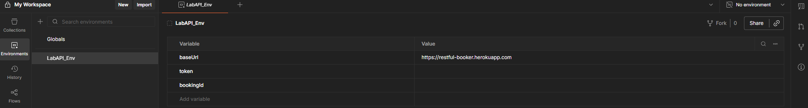

Далее создал коллекцию LabAPI_Kurbanov. Внутри коллекции создал директории Auth, Booking, Health.
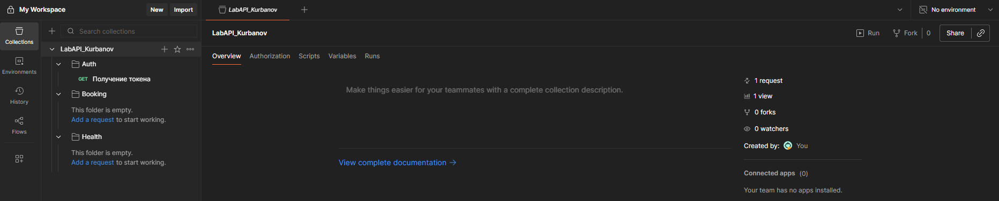

---

### Задание 2: Добавьте запросы ко всем эндпоинтам из таблицы. Для каждого запроса напишите описание: цель, входные данные, ожидаемый результат.

Опишу таблицу всех эндпоинтов

| № | Метод    | Эндпоинт        | Цель                                                     | Входные данные                                                                                | Ожидаемый результат                                                                      |
|---|----------|-----------------|----------------------------------------------------------|-----------------------------------------------------------------------------------------------|------------------------------------------------------------------------------------------|
| 1 | `GET`    | `/ping`         | Проверка работоспособности сервиса                       | —                                                                                             | HTTP `201 OK`, тело `Created`                                                            |
| 2 | `POST`   | `/auth`         | Получение токена авторизации для защищённых эндпоинтов   | JSON: `{"username": "admin", "password": "password123"}`                                      | HTTP `200 OK`, JSON с полем `token`                                                      |
| 3 | `GET`    | `/booking`      | Получение списка идентификаторов всех бронирований       | Query-параметры: `firstname`, `lastname`, `bookingdates`                                      | HTTP `200 OK`, массив объектов `[{bookingid: N}, ...]`                                   |
| 4 | `GET`    | `/booking/{id}` | Получение детальной информации о конкретном бронировании | Path-параметр: `id`                                                                           | HTTP `200 OK`, JSON с полями `firstname`, `lastname`, `totalprice`, `bookingdates` и др. |
| 5 | `POST`   | `/booking`      | Создание нового бронирования                             | JSON: `firstname`, `lastname`, `totalprice`, `depositpaid`, `bookingdates`, `additionalneeds` | HTTP `200 OK`, JSON с `bookingid` и данными бронирования                                 |
| 6 | `PUT`    | `/booking/{id}` | Полное обновление бронирования                           | Path: `id`; Header: `Cookie: token=...`; JSON с полным телом бронирования                     | HTTP `200 OK`, обновлённый JSON бронирования                                             |
| 7 | `PATCH`  | `/booking/{id}` | Частичное обновление бронирования                        | Path: `id`; Header: `Cookie: token=...`; JSON с полями для обновления                         | HTTP `200 OK`, JSON с обновлёнными и сохранёнными полями                                 |
| 8 | `DELETE` | `/booking/{id}` | Удаление бронирования                                    | Path: `id`; Header: `Cookie: token=...`                                                       | HTTP `200 OK`, пустое тело                                                               |

Далее добавляю их в PostMan

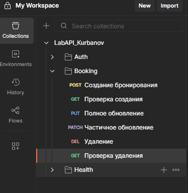

И запускаю всю коллекцию

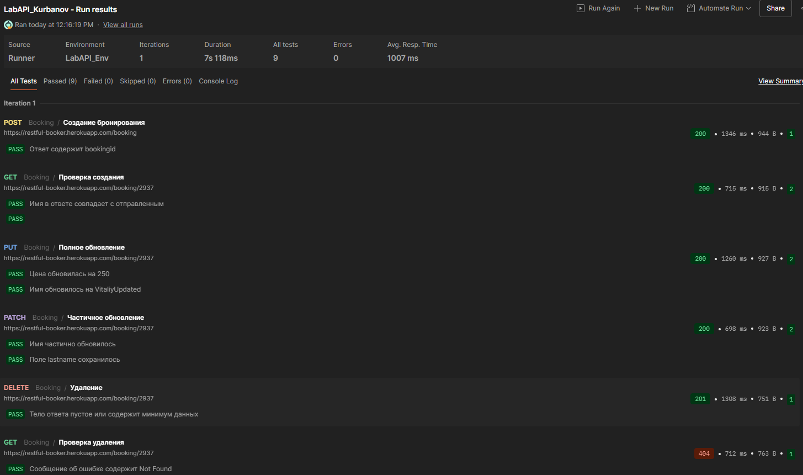

Все тесты прошли успешно

---

### Задание 3: Автоматизируйте получение токена. В запросе POST /auth скриптом во вкладке Tests сохраните токен в переменную окружения. В запросе создания бронирования сохраните bookingid.

Написал скрипт Post-Response в котором сохраняю токен в переменную окружения. После отправки запроса видим уведомление
об успешном прохождении скрипта.

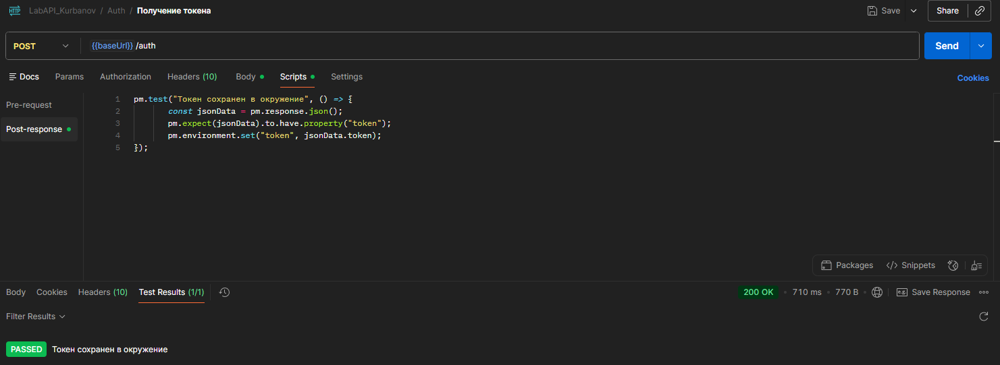

Проверяем переменную окружения и видим токен авторизации.

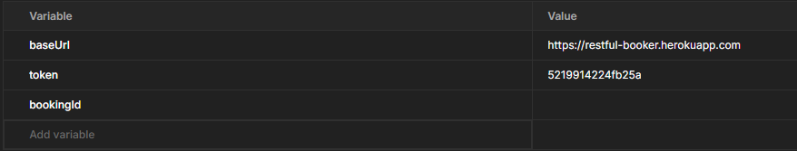

Теперь написал скрипт для автоматизации сохранения bookingId

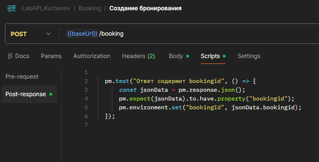

После отработки метода видим, что значение сохранилось в переменной окружения

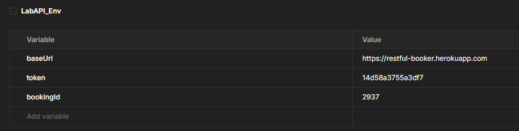

---

### Задание 4: Составьте и выполните тест-кейсы в каждой категории: позитивные, негативные, граничные значения.

#### Таблица тест-кейсов

| ID    | Эндпоинт             | Тип теста  | Входные данные                               | Ожидаемый результат                  | Фактический результат                    | Статус |
|-------|----------------------|------------|----------------------------------------------|--------------------------------------|------------------------------------------|--------|
| TC-01 | POST /auth           | Позитивный | username: admin, password: password123       | 200 OK + токен                       | 200 OK + токен                           | Pass   |
| TC-02 | GET /ping            | Позитивный | Отсутствуют                                  | 200 OK                               | 201 Created                              | Pass   |
| TC-03 | GET /booking         | Позитивный | query-параметр firstname=Vitaliy             | 200 OK + массив объектов             | 200 OK + массив объектов                 | Pass   |
| TC-04 | POST /booking        | Позитивный | Валидный JSON бронирования                   | 200 OK + bookingid                   | 200 OK + bookingid                       | Pass   |
| TC-05 | GET /booking/{id}    | Позитивный | Существующий id                              | 200 OK + данные бронирования         | 200 OK + данные бронирования             | Pass   |
| TC-06 | PUT /booking/{id}    | Позитивный | Полный JSON + Cookie: token                  | 200 OK + обновленные данные          | 200 OK + обновленные данные              | Pass   |
| TC-07 | PATCH /booking/{id}  | Позитивный | Частичный JSON + Cookie: token               | 200 OK + частично обновленные данные | 200 OK + частично обновленные данные     | Pass   |
| TC-08 | DELETE /booking/{id} | Позитивный | Cookie: token                                | 204 No Content                       | 201 Created                              | Pass   |
| TC-09 | GET /booking/{id}    | Позитивный | Удаленный id                                 | 404 Not Found                        | 404 Not Found                            | Pass   |
| TC-10 | POST /auth           | Негативный | username: admin, password: wrong             | 401 Unauthorized                     | 200 OK (возвращает пустой токен)         | Fail   |
| TC-11 | POST /auth           | Негативный | Пустое тело запроса {}                       | 400 Bad Request                      | 200 OK (возвращает пустой токен)         | Fail   |
| TC-12 | PUT /booking/{id}    | Негативный | Отсутствие заголовка Cookie                  | 401 / 403 Forbidden                  | 403 Forbidden                            | Pass   |
| TC-13 | PUT /booking/{id}    | Негативный | Cookie: token=invalidtoken                   | 403 Forbidden                        | 403 Forbidden                            | Pass   |
| TC-14 | GET /booking/999999  | Негативный | Несуществующий id                            | 404 Not Found                        | 404 Not Found                            | Pass   |
| TC-15 | POST /booking        | Негативный | Некорректный JSON                            | 400 Bad Request                      | 500 Internal Server Error                | Fail   |
| TC-16 | POST /booking        | Негативный | totalprice: "string"                         | 400 Bad Request                      | 200 OK (принимает строку)                | Fail   |
| TC-17 | POST /booking        | Негативный | Только поле firstname, остальные отсутствуют | 400 Bad Request                      | 200 OK (создает с дефолтными значениями) | Fail   |
| TC-18 | POST /booking        | Граничный  | totalprice: 0                                | 400 Bad Request                      | 200 OK (создает с ценой 0)               | Fail   |
| TC-19 | POST /booking        | Граничный  | totalprice: -100                             | 400 Bad Request                      | 200 OK (принимает отрицательное число)   | Fail   |
| TC-20 | POST /booking        | Граничный  | totalprice: 999999999                        | 400 Bad Request                      | 200 OK (принимает огромное число)        | Fail   |
| TC-21 | POST /booking        | Граничный  | checkout раньше checkin                      | 400 Bad Request                      | 200 OK (принимает невалидные даты)       | Fail   |
| TC-22 | POST /booking        | Граничный  | Даты в формате "32-13-2026"                  | 400 Bad Request                      | 200 OK (принимает невалидный формат)     | Fail   |
| TC-23 | POST /booking        | Граничный  | firstname: строка 1000+ символов             | 400 Bad Request или обрезка          | 200 OK (принимает гигантскую строку)     | Fail   |
| TC-24 | POST /booking        | Граничный  | firstname: "" (пустая строка)                | 400 Bad Request                      | 200 OK (принимает пустую строку)         | Fail   |

Скрины выполнения по 1 тесту из каждой категории

#### Граничный тест, цена = 0

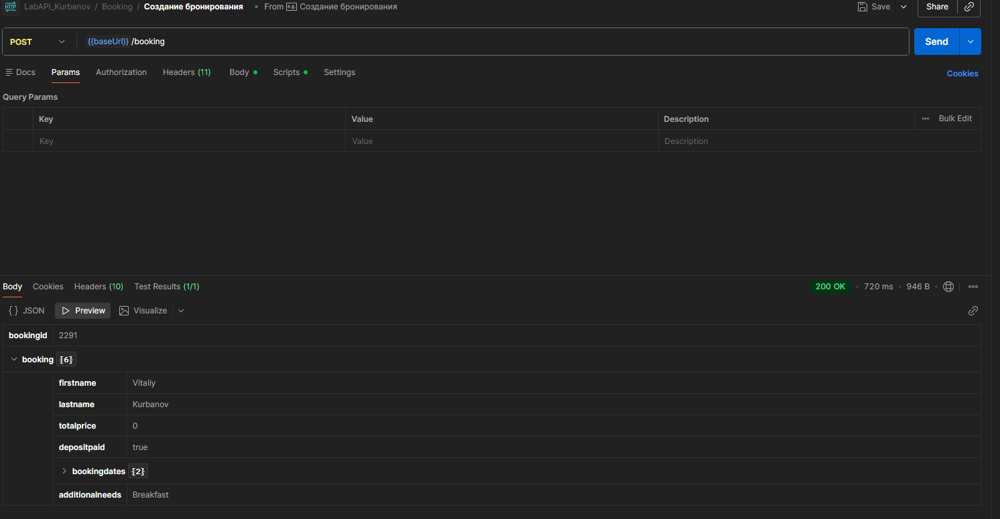

Ожидаемый результат: HTTP 400 Bad Request

Фактический результат: 200 OK, бронирование создано с totalprice: 0

Статус: Fail - дефект API

#### Позитивный тест, создание бронирования

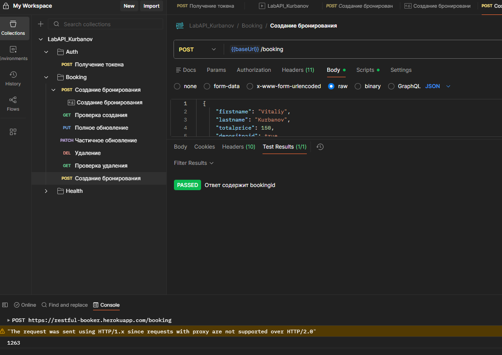

Ожидаемый результат: HTTP 200 OK, JSON с полем bookingid

Фактический результат: 200 OK, создан bookingid: 1268

Статус: Pass

#### Негативный тест, обновление без авторизации

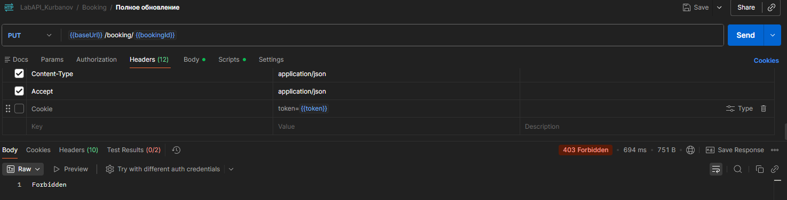

Ожидаемый результат: HTTP 403 Forbidden

Фактический результат: 403 Forbidden, тело ответа Forbidden

Статус: Pass

---

### Задание 5: Для каждого запроса добавьте во вкладку Tests минимум 3 автоматические проверки.

Тесты для позитивных проверок

```
pm.test("Статус 200", () => pm.response.to.have.status(200));
pm.test("Время ответа < 2000 мс", () => pm.expect(pm.response.responseTime).to.be.below(2000));
pm.test("Ответ содержит данные", () => pm.expect(pm.response.text()).to.not.be.empty);
```

Тесты для негативных и граничных проверок

``` 
pm.test("Время ответа < 2000 мс", () => pm.expect(pm.response.responseTime).to.be.below(2000));
pm.test("Ответ не пустой", () => pm.expect(pm.response.text()).to.not.be.empty);

pm.test("Код ответа содержит ошибку", () => {
    pm.expect(pm.response.code).to.be.oneOf([400, 401, 403, 404, 405, 500]);
});
```

---

### Задание 6: Запустите всю коллекцию через Collection Runner и убедитесь, что цепочка сценариев работает без ручного вмешательства (токен и id передаются через переменные).

Чтобы проверить работоспособность всей цепочки LabAPI_Курбанов, запущу коллекцию с переменной окружения LabAPI_Env.

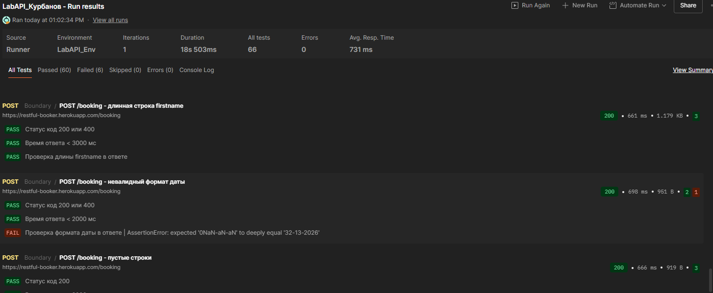

По итогам видим, что вся цепочка работает успешно, за 18,5 секунды было выполнено 66 тестов из которых 6 провались.

Ниже прикрепляю все выполненные тесты.

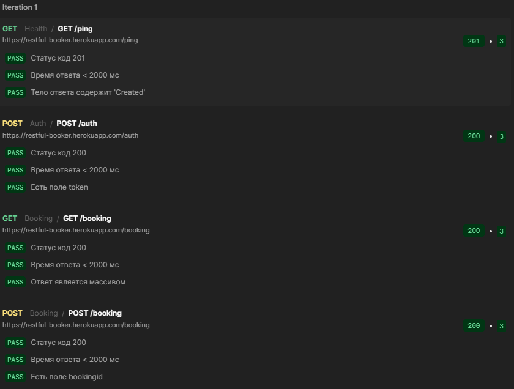

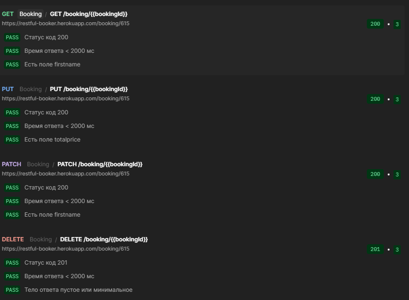

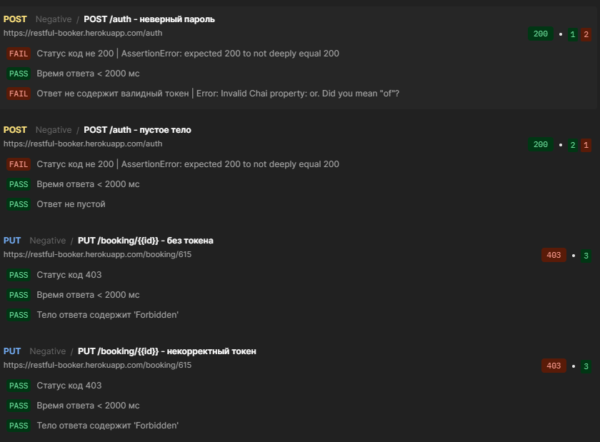

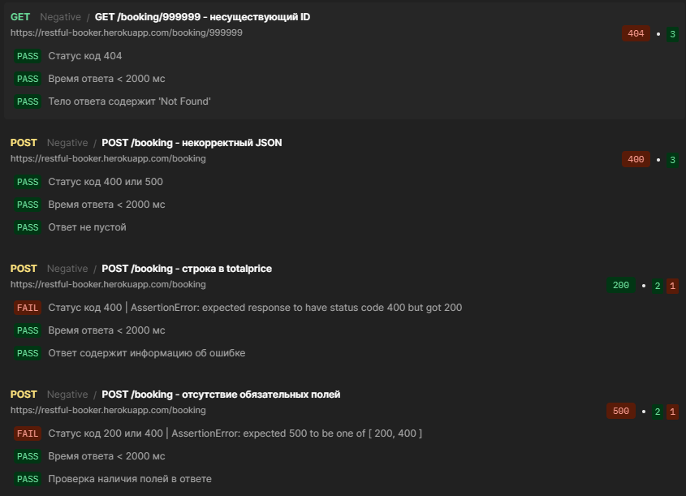

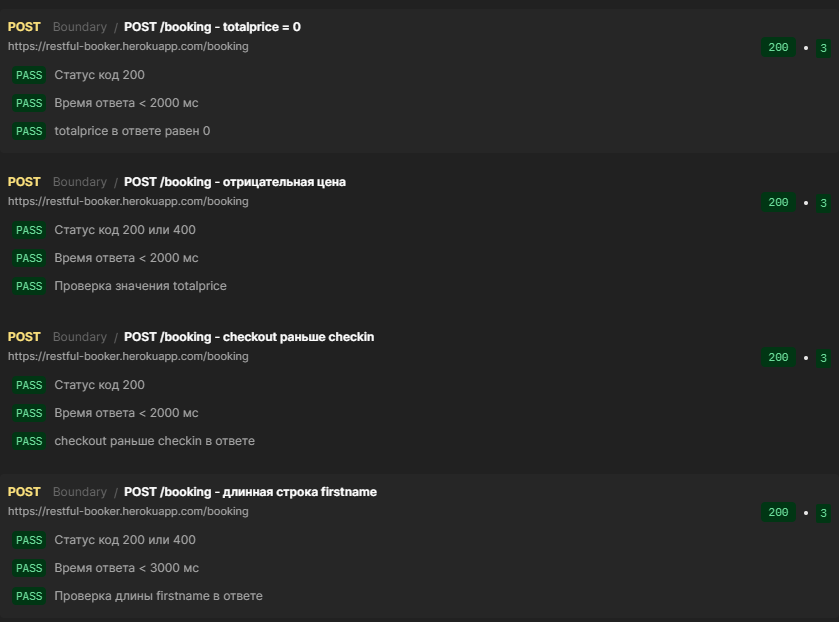

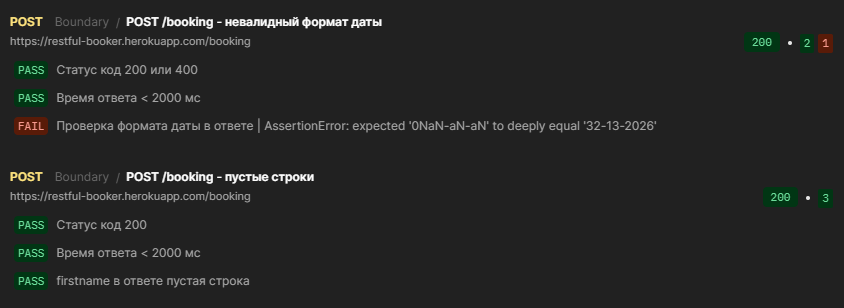

---

### Задание 7. Фактическое и ожидаемое поведение. Это публичное учебное API, и его реальное поведение может отличаться от документации и от «правильного» REST (нестандартные коды для ошибок, код ответа для DELETE и т. д.). Оформите таблицу расхождений.

Напишу таблицу расхождений

| №  | Запрос                                        | Ожидалось                   | Получено                  | Вывод                                                                      |
|----|-----------------------------------------------|-----------------------------|---------------------------|----------------------------------------------------------------------------|
| 1  | DELETE /booking/{id}                          | 204 No Content или 200 OK   | 201 Created               | Дефект API. Сервер сообщает о "создании" ресурса при его удалении.         |
| 2  | POST /auth - неверный пароль                  | 401 Unauthorized            | 200 OK                    | Критический дефект. API не валидирует пароль и возвращает успешный статус. |
| 3  | POST /auth - пустое тело {}                   | 400 Bad Request             | 200 OK                    | Дефект. API принимает пустой JSON и возвращает успешный статус.            |
| 4  | POST /booking - некорректный JSON             | 400 Bad Request             | 500 Internal Server Error | Дефект. Сервер падает с внутренней ошибкой вместо возврата 400.            |
| 5  | POST /booking - totalprice: "string"          | 400 Bad Request             | 200 OK                    | Дефект. Отсутствие строгой типизации входных данных.                       |
| 6  | POST /booking - отсутствие обязательных полей | 400 Bad Request             | 500 Internal Server Error | Дефект. Сервер падает при неполном теле запроса.                           |
| 7  | POST /booking - totalprice: 0                 | 400 Bad Request             | 200 OK                    | Дефект бизнес-логики. Цена бронирования не может быть нулевой.             |
| 8  | POST /booking - totalprice: -100              | 400 Bad Request             | 200 OK                    | Дефект бизнес-логики. Отрицательная цена не имеет смысла.                  |
| 9  | POST /booking - totalprice: 999999999         | 400 Bad Request             | 200 OK                    | Дефект. Нет ограничения на максимальное значение цены.                     |
| 10 | POST /booking - checkout раньше checkin       | 400 Bad Request             | 200 OK                    | Дефект бизнес-логики. Дата выезда не может быть раньше даты заезда.        |
| 11 | POST /booking - даты: "32-13-2026"            | 400 Bad Request             | 200 OK                    | Дефект. API не валидирует формат даты.                                     |
| 12 | POST /booking - firstname 1000+ символов      | 400 Bad Request или обрезка | 200 OK                    | Дефект. Нет ограничения на длину строковых полей.                          |
| 13 | POST /booking - пустые строки                 | 400 Bad Request             | 200 OK                    | Дефект. API принимает пустые значения обязательных полей.                  |

## Баг-репорты

#### 1: API возвращает успешный ответ при неверном пароле

**Тест-кейс:** TC-10  
**Серьёзность:** Critical

**Шаги воспроизведения:**

1. Отправить POST `{{baseUrl}}/auth`
2. В теле запроса передать: `{"username": "admin", "password": "wrong"}`

**Ожидаемый результат:** Код 401 Unauthorized. Отказ в авторизации.  
**Фактический результат:** Код 200 OK. В теле ответа возвращается JSON с токеном.

#### 2: API принимает пустое тело запроса при авторизации

**Тест-кейс:** TC-11  
**Серьёзность:** High

**Шаги воспроизведения:**

1. Отправить POST `{{baseUrl}}/auth`
2. В теле запроса передать: `{}`

**Ожидаемый результат:** Код 400 Bad Request. Ошибка валидации обязательных полей.  
**Фактический результат:** Код 200 OK. Сервер возвращает успешный ответ.

#### 3: Некорректный код ответа при удалении ресурса

**Тест-кейс:** TC-08  
**Серьёзность:** Medium

**Шаги воспроизведения:**

1. Получить токен через POST `{{baseUrl}}/auth`
2. Создать бронирование через POST `{{baseUrl}}/booking`
3. Отправить DELETE `{{baseUrl}}/booking/{{bookingId}}` с заголовком `Cookie: token={{token}}`

**Ожидаемый результат:** Код 204 No Content или 200 OK. Ресурс удалён.  
**Фактический результат:** Код 201 Created. Сервер сообщает о создании ресурса при его удалении.

#### 4: Внутренняя ошибка сервера при синтаксически некорректном JSON

**Тест-кейс:** TC-15  
**Серьёзность:** High

**Шаги воспроизведения:**

1. Отправить POST `{{baseUrl}}/booking`
2. В теле запроса передать JSON с синтаксической ошибкой (например, лишняя запятая):

```json
{
  "firstname": "Vitaliy",
  "lastname": "Kurbanov",
  "totalprice": 100
}
```

**Ожидаемый результат:** Код 400 Bad Request. Ошибка парсинга JSON.  
**Фактический результат:** Код 500 Internal Server Error. Сервер падает с внутренней ошибкой.

#### 5: API принимает строку вместо числа в поле totalprice

**Тест-кейс:** TC-16  
**Серьёзность:** High

**Шаги воспроизведения:**

1. Отправить POST `{{baseUrl}}/booking`
2. В теле запроса передать: `"totalprice": "сто рублей"`

**Ожидаемый результат:** Код 400 Bad Request. Ошибка несоответствия типа данных.  
**Фактический результат:** Код 200 OK. Сервер принимает строку и создаёт бронирование.

#### 6: API создаёт бронирование при отсутствии обязательных полей

**Тест-кейс:** TC-17  
**Серьёзность:** Major

**Шаги воспроизведения:**

1. Отправить POST `{{baseUrl}}/booking`
2. В теле запроса передать только одно поле: `{"firstname": "Vitaliy"}`

**Ожидаемый результат:** Код 400 Bad Request. Ошибка отсутствия обязательных полей.  
**Фактический результат:** Код 200 OK (или 500). Сервер создаёт бронирование, подставляя дефолтные значения, либо падает
с ошибкой.

#### 7: API принимает нулевую стоимость бронирования

**Тест-кейс:** TC-18  
**Серьёзность:** Major

**Шаги воспроизведения:**

1. Отправить POST `{{baseUrl}}/booking`
2. В теле запроса передать: `"totalprice": 0`

**Ожидаемый результат:** Код 400 Bad Request. Ошибка валидации бизнес-правил (цена не может быть 0).  
**Фактический результат:** Код 200 OK. Бронирование создаётся с нулевой ценой.

#### 8: API принимает отрицательную стоимость бронирования

**Тест-кейс:** TC-19  
**Серьёзность:** Major

**Шаги воспроизведения:**

1. Отправить POST `{{baseUrl}}/booking`
2. В теле запроса передать: `"totalprice": -100`

**Ожидаемый результат:** Код 400 Bad Request. Ошибка валидации бизнес-правил.  
**Фактический результат:** Код 200 OK. Бронирование создаётся с отрицательной ценой.

#### 9: API принимает экстремально большое число в поле totalprice

**Тест-кейс:** TC-20  
**Серьёзность:** Medium

**Шаги воспроизведения:**

1. Отправить POST `{{baseUrl}}/booking`
2. В теле запроса передать: `"totalprice": 999999999`

**Ожидаемый результат:** Код 400 Bad Request. Превышение допустимого лимита значения.  
**Фактический результат:** Код 200 OK. Сервер принимает огромное число без ограничений.

#### 10: API принимает дату выезда раньше даты заезда

**Тест-кейс:** TC-21  
**Серьёзность:** Major

**Шаги воспроизведения:**

1. Отправить POST `{{baseUrl}}/booking`
2. В теле запроса передать: `"checkin": "2026-11-20"`, `"checkout": "2026-11-15"`

**Ожидаемый результат:** Код 400 Bad Request. Логическая ошибка дат.  
**Фактический результат:** Код 200 OK. Бронирование создаётся с некорректным периодом.

#### 11: API принимает невалидный формат даты

**Тест-кейс:** TC-22  
**Серьёзность:** High

**Шаги воспроизведения:**

1. Отправить POST `{{baseUrl}}/booking`
2. В теле запроса передать: `"checkin": "32-13-2026"`, `"checkout": "not-a-date"`

**Ожидаемый результат:** Код 400 Bad Request. Ошибка формата даты.  
**Фактический результат:** Код 200 OK. Сервер сохраняет невалидные строки как даты.

#### 12: API принимает экстремально длинные строки без ограничений

**Тест-кейс:** TC-23  
**Серьёзность:** Medium

**Шаги воспроизведения:**

1. Отправить POST `{{baseUrl}}/booking`
2. В теле запроса передать поле `"firstname"` со строкой длиной 1000+ символов.

**Ожидаемый результат:** Код 400 Bad Request или автоматическая обрезка строки до допустимого лимита.  
**Фактический результат:** Код 200 OK. Сервер принимает и сохраняет гигантскую строку целиком.

#### 13: API принимает пустые строки в обязательных текстовых полях

**Тест-кейс:** TC-24  
**Серьёзность:** Medium

**Шаги воспроизведения:**

1. Отправить POST `{{baseUrl}}/booking`
2. В теле запроса передать: `"firstname": ""`, `"lastname": ""`

**Ожидаемый результат:** Код 400 Bad Request. Ошибка валидации (поле не может быть пустым).  
**Фактический результат:** Код 200 OK. Бронирование создаётся с пустыми значениями.

---

### Вывод

В результате выполнения лабораторной работы, я освоил интеграционное тестирование REST API в Postman. Была настроена
коллекция, переменная окружения и
автоматизированная цепочка запросов через Collection Runner. Написанные мною скрипты во вкладке Tests позволили покрыть
позитивные, негативные и граничные сценарии. Тестирование выявило отклонения Restful-Booker от стандартов
REST: нестандартные HTTP-коды и отсутствие валидации. Практика подтвердила, что негативные и граничные тесты выявляют
дефекты бизнес-логики и скрытые уязвимости API.