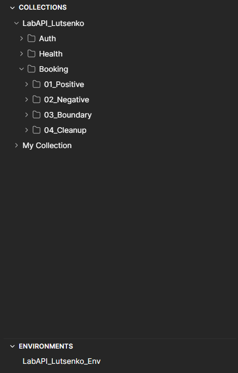
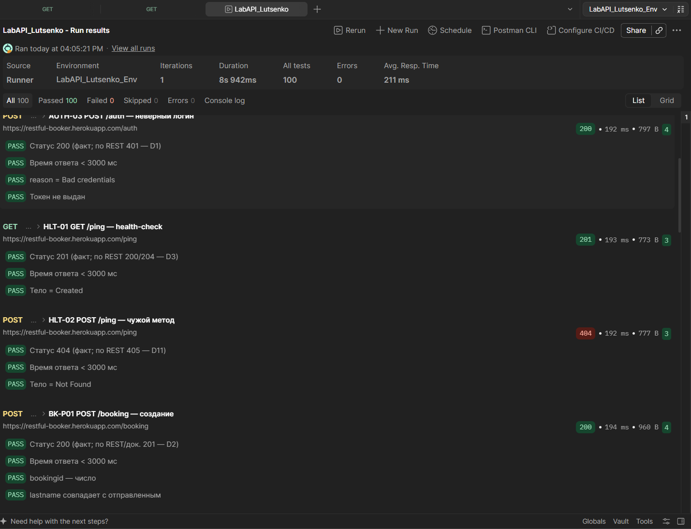
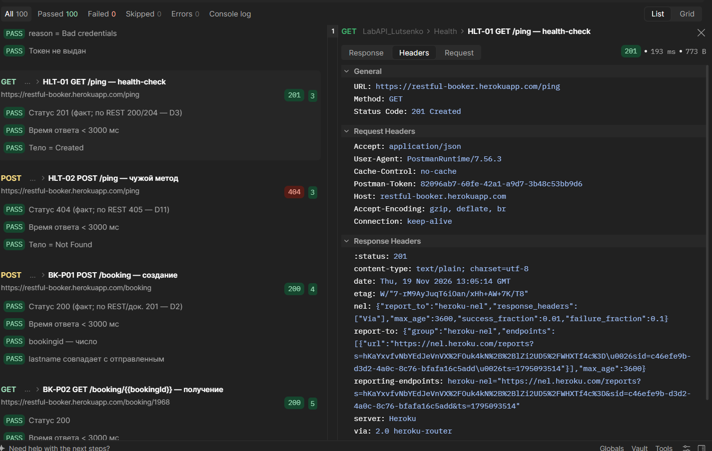
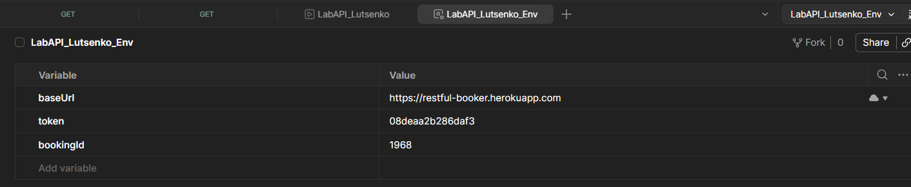
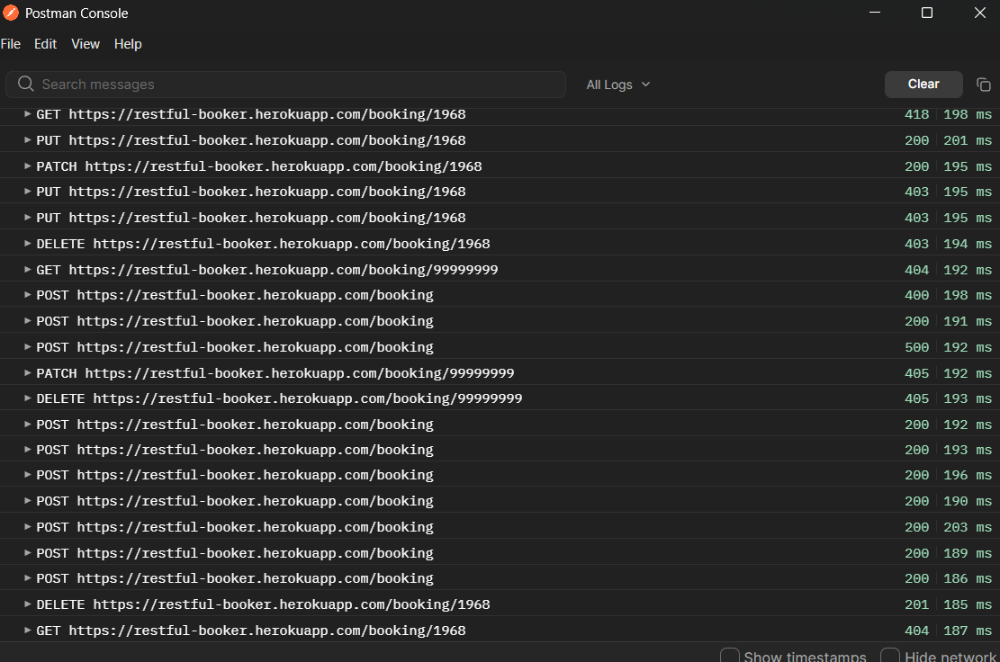
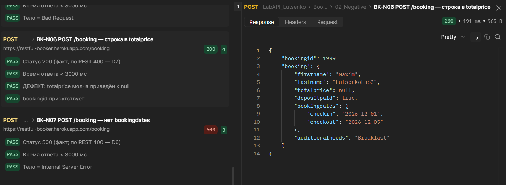

# Лабораторная работа № 3 «Интеграционное и API-тестирование»

**Выполнил:** Луценко Максим  
**Группа:** ВТ-232 

---

## 1. Цель работы

Освоить тестирование REST API на примере открытого публичного сервиса: построить в Postman коллекцию запросов с переменными окружения, написать автоматические проверки (Tests), выполнить сквозной прогон через Collection Runner и проанализировать расхождения между документацией, принципами REST и фактическим поведением API.

## 2. Тестируемая система

Restful-Booker — открытое учебное REST API бронирования отелей (Node.js/Express, хостинг Heroku). Особенности стенда: данные сбрасываются примерно каждые 10 минут; модифицирующие операции требуют токен в Cookie.

| Метод | Эндпоинт | Назначение | Авторизация |
|---|---|---|---|
| POST | /auth | выдача токена (admin / password123) | нет |
| GET | /booking | список идентификаторов, фильтры firstname/lastname/checkin/checkout | нет |
| GET | /booking/{id} | получение бронирования | нет |
| POST | /booking | создание бронирования | нет |
| PUT | /booking/{id} | полное обновление | Cookie token=... |
| PATCH | /booking/{id} | частичное обновление | Cookie token=... |
| DELETE | /booking/{id} | удаление | Cookie token=... |
| GET | /ping | проверка работоспособности | нет |

## 3. Коллекция и окружение

**Коллекция:** `LabAPI_Lutsenko` — 29 запросов, 100 автоматических проверок (в каждом запросе не менее трёх: статус-код, время ответа < 3000 мс, содержимое тела/полей).

Структура:
- **Auth** — AUTH-01 (валидный вход), AUTH-02 (неверный пароль), AUTH-03 (неверный логин);
- **Health** — HLT-01 (GET /ping), HLT-02 (POST /ping, чужой метод);
- **Booking / 01_Positive** — BK-P01…BK-P05 (создание → получение → фильтр → PUT → PATCH), BK-X01 (Accept: text/plain, пасхалка 418);
- **Booking / 02_Negative** — BK-N01…BK-N09 (без токена, битый токен, несуществующий id, битый JSON, неверный тип, отсутствие обязательного поля);
- **Booking / 03_Boundary** — BK-B01…BK-B07 (пустые строки, 1200 символов, цена 0/−100/999999999999999, инверсия дат, невалидная дата);
- **Booking / 04_Cleanup** — BK-C01 (DELETE), BK-C02 (повторный GET, ожидается 404).

**Переменные окружения** `LabAPI_Lutsenko_Env`:

| Переменная | Значение | Кто заполняет |
|---|---|---|
| baseUrl | https://restful-booker.herokuapp.com | задано вручную |
| token | (пусто) | скрипт Tests запроса AUTH-01: pm.environment.set("token", ...) |
| bookingId | (пусто) | скрипт Tests запроса BK-P01: pm.environment.set("bookingId", ...) |

Дополнительно: BK-B02 генерирует строку из 1200 символов pre-request скриптом (pm.variables.set). Каждый запрос снабжён описанием: цель, входные данные, ожидаемый результат. Проверки написаны на фактическое поведение API, чтобы прогон был полностью «зелёным»; отклонения от REST зафиксированы в названиях тестов и в таблице расхождений (раздел 7).

**Порядок воспроизведения:** Import обоих JSON → выбрать окружение LabAPI_Lutsenko_Env → Run collection → 1 итерация, порядок сверху вниз. Ручное вмешательство не требуется: токен и id передаются через переменные.

## 4. Таблица тест-кейсов

Статус «Pass» — автоматические проверки Postman выполнены успешно; «D#» — ссылка на расхождение из раздела 7.

| ID | Эндпоинт | Тип | Входные данные | Ожидалось (REST/док.) | Факт | Статус |
|---|---|---|---|---|---|---|
| AUTH-01 | POST /auth | позит. | admin / password123 | 200, token | 200, token (15 симв.) | Pass |
| AUTH-02 | POST /auth | негат. | admin / wrongpass | 401 | 200 {"reason":"Bad credentials"} | Pass, D1 |
| AUTH-03 | POST /auth | негат. | hacker / password123 | 401 | 200 {"reason":"Bad credentials"} | Pass, D1 |
| HLT-01 | GET /ping | позит. | — | 200/204 | 201 «Created» | Pass, D3 |
| HLT-02 | POST /ping | негат. | — | 405 | 404 «Not Found» | Pass, D11 |
| BK-P01 | POST /booking | позит. | валидный JSON, цена 150 | 201 + Location | 200, bookingid, без Location | Pass, D2 |
| BK-P02 | GET /booking/{id} | позит. | id созданной брони | 200, поля совпадают | 200, все поля совпадают | Pass |
| BK-P03 | GET /booking?firstname&lastname | позит. | Maxim / LutsenkoLab3 | 200, массив с id | 200, [{bookingid}] | Pass |
| BK-X01 | GET /booking/{id} | особ. | Accept: text/plain | 406 / JSON | 418 «I'm a Teapot» | Pass, D12 |
| BK-P04 | PUT /booking/{id} | позит. | полный JSON + токен | 200, всё обновлено | 200, все поля обновлены | Pass |
| BK-P05 | PATCH /booking/{id} | позит. | 2 поля + токен | 200, частично | 200, остальные поля не тронуты | Pass |
| BK-N01 | PUT /booking/{id} | негат. | без Cookie | 401 | 403 «Forbidden» | Pass, D5 |
| BK-N02 | PUT /booking/{id} | негат. | token=invalidtoken123 | 401 | 403 «Forbidden» | Pass, D5 |
| BK-N03 | DELETE /booking/{id} | негат. | без Cookie | 401 | 403 «Forbidden» | Pass, D5 |
| BK-N04 | GET /booking/99999999 | негат. | несуществующий id | 404 | 404 «Not Found» | Pass |
| BK-N05 | POST /booking | негат. | битый JSON | 400 | 400 «Bad Request» | Pass |
| BK-N06 | POST /booking | негат. | totalprice="abc" | 400 | 200, totalprice=null | Pass, D7 |
| BK-N07 | POST /booking | негат. | без bookingdates | 400 | 500 «Internal Server Error» | Pass, D6 |
| BK-N08 | PATCH /booking/99999999 | негат. | id + валидный токен | 404 | 405 «Method Not Allowed» | Pass, D8 |
| BK-N09 | DELETE /booking/99999999 | негат. | id + валидный токен | 404 | 405 «Method Not Allowed» | Pass, D8 |
| BK-B01 | POST /booking | гран. | firstname="", lastname="" | 400 | 200, пустые строки сохранены | Pass, D9 |
| BK-B02 | POST /booking | гран. | firstname = 1200 символов | 400/413 | 200, сохранено без усечения | Pass, D9 |
| BK-B03 | POST /booking | гран. | totalprice=0 | 200 (допустимо) | 200, сохранён 0 | Pass |
| BK-B04 | POST /booking | гран. | totalprice=-100 | 400 | 200, сохранено −100 | Pass, D9 |
| BK-B05 | POST /booking | гран. | totalprice=999999999999999 | 400 | 200, значение сохранено | Pass, D9 |
| BK-B06 | POST /booking | гран. | checkout 12-01 < checkin 12-10 | 400 | 200, инверсия принята | Pass, D9 |
| BK-B07 | POST /booking | гран. | checkin="not-a-date" | 400 | 200, checkin=«0NaN-aN-aN» | Pass, D10 |
| BK-C01 | DELETE /booking/{id} | позит. | id + токен | 204/200 | 201 «Created» | Pass, D4 |
| BK-C02 | GET /booking/{id} | позит. | id удалённой брони | 404 | 404 «Not Found» | Pass |

Дополнительный эксперимент (вне коллекции): checkin="2026-02-30" → 200, дата молча сдвинута на 2026-03-02 (подтверждает D10).

Фактически полученные коды ответов: **200, 201, 400, 403, 404, 405, 418, 500**. Код **401** API не возвращает ни в одном сценарии (вместо него — 200 при ошибке входа и 403 при ошибке токена).

## 5. Результаты прогона (Collection Runner)

Итог: **29 запросов, 100 проверок, 0 failed**. Среднее время ответа ~0,9 с; порог в проверках — 3000 мс (запас на сетевые задержки и холодный старт dyno). Цепочка сценариев выполняется без ручного вмешательства.

## 6. Подтверждение передачи данных через переменные

<!-- СКРИНШОТ 05: View → Show Postman Console; найти запрос BK-P04 (PUT) или BK-C01 (DELETE) — в реальном URL стоит числовой id, в заголовке Cookie — реальный токен -->

## 7. Таблица расхождений с документацией и REST

| № | Запрос | Ожидалось (по REST/документации) | Получено | Вывод |
|---|---|---|---|---|
| D1 | POST /auth, неверные данные | 401 Unauthorized | 200 + {"reason":"Bad credentials"} | дефект (маскировка ошибки аутентификации) |
| D2 | POST /booking, валидный | 201 Created + Location | 200, заголовка Location нет | дефект (семантика создания) |
| D3 | GET /ping | 200/204 | 201 «Created» | особенность/дефект (код не соответствует операции) |
| D4 | DELETE /booking/{id} | 204/200 | 201 «Created» | дефект (код создания при удалении) |
| D5 | PUT/PATCH/DELETE без/с битым токеном | 401 Unauthorized | 403 «Forbidden» | особенность (401 не используется вовсе) |
| D6 | POST /booking без обязательного поля | 400 с указанием поля | 500 «Internal Server Error» | дефект (нет валидации, падение сервера) |
| D7 | POST /booking, totalprice — строка | 400 (ошибка типа) | 200, totalprice=null | дефект (молчаливая порча данных) |
| D8 | PUT/PATCH/DELETE несуществующего id | 404 Not Found | 405 «Method Not Allowed» | дефект (вводит в заблуждение) |
| D9 | Пустые/1200-символьные строки; цена 0/−100/10^15; checkout<checkin | 400/422 (валидация) | 200, всё сохраняется | дефект (отсутствует бизнес-валидация) |
| D10 | Невалидная дата | 400 | 200, «0NaN-aN-aN»; «2026-02-30»→«2026-03-02» | дефект (искажение данных) |
| D11 | POST /ping | 405 Method Not Allowed | 404 «Not Found» | особенность Express (маршрут не найден) |
| D12 | GET /booking/{id}, Accept: text/plain | 406 / контент по negotiаtion | 418 «I'm a Teapot» | особенность (пасхалка, не дефект) |

## 8. Баг-репорты

### BUG-01. 200 OK при неверных учётных данных (D1)
- **Шаги:** POST /auth с телом {"username":"admin","password":"wrongpass"}.
- **Ожидаемо:** 401 Unauthorized, токен не выдан.
- **Факт:** 200 OK, {"reason":"Bad credentials"}.
- **Серьёзность:** Большая (клиент, ориентирующийся на код ответа, считает вход успешным).

### BUG-02. Молчаливое превращение цены в null (D7)
- **Шаги:** POST /booking с валидным JSON, но totalprice:"abc".
- **Ожидаемо:** 400, ошибка типа поля.
- **Факт:** 200, бронь создана с totalprice:null.
- **Серьёзность:** Критическая (тихая порча финансовых данных без сигнала клиенту).

### BUG-03. 500 при отсутствии обязательного поля (D6)
- **Шаги:** POST /booking без bookingdates (аналогично — без lastname).
- **Ожидаемо:** 400 с указанием отсутствующего поля.
- **Факт:** 500 «Internal Server Error».
- **Серьёзность:** Большая.

### BUG-04. Отсутствует бизнес-валидация (D9)
- **Шаги:** POST /booking с totalprice:-100; с пустыми firstname/lastname; с checkout раньше checkin.
- **Ожидаемо:** 400/422, отказ в создании.
- **Факт:** 200, некорректные брони сохраняются.
- **Серьёзность:** Большая.

### BUG-05. Искажение невалидных дат (D10)
- **Шаги:** POST /booking с checkin:"not-a-date"; отдельно — с "2026-02-30".
- **Ожидаемо:** 400, ошибка формата даты.
- **Факт:** 200; дата становится «0NaN-aN-aN» либо молча сдвигается на «2026-03-02».
- **Серьёзность:** Большая.

### BUG-06. DELETE возвращает 201 Created (D4)
- **Шаги:** DELETE /booking/{id} с валидным токеном.
- **Ожидаемо:** 204 No Content (или 200).
- **Факт:** 201 «Created».
- **Серьёзность:** малая.

### BUG-07. 405 вместо 404 для несуществующего id (D8)
- **Шаги:** PATCH/DELETE /booking/99999999 с валидным токеном.
- **Ожидаемо:** 404 Not Found.
- **Факт:** 405 «Method Not Allowed».
- **Серьёзность:** малая.

## 9. Выводы

Построена автономная коллекция из 29 запросов (100 автопроверок), покрывающая все 8 эндпоинтов Restful-Booker: позитивную CRUD-цепочку, негативные и граничные сценарии. Токен и идентификатор брони передаются через переменные окружения, прогон выполняется без ручных действий. Базовая функциональность (создание, чтение, фильтрация, полное и частичное обновление, удаление, защита модифицирующих операций) работает стабильно. Вместе с тем выявлено 12 расхождений с REST/документацией и оформлено 7 баг-репортов. Наиболее опасны дефекты «тихой» порчи данных: строка в totalprice молча превращается в null, невалидная дата — в «0NaN-aN-aN», а отсутствие обязательного поля роняет сервер в 500 вместо 400. Полностью отсутствует бизнес-валидация (отрицательные цены, инверсия дат, пустые и 1200-символьные строки принимаются). Коды ответов систематически нарушают семантику HTTP: 200 при ошибке аутентификации, 201 при DELETE и health-check, 405 вместо 404, 403 вместо 401. Сервис пригоден для обучения тестированию, но не может служить эталоном корректного REST. Освоены: chaining через переменные, написание assertions, прогон в Collection Runner и методика фиксации расхождений «документация — ожидание — факт» с классификацией «дефект/особенность».