# Лабораторная работа № 2 «Интеграционное и API-тестирование»

**Выполнила:** Агафонова Дарья  
**Группа:** ВТ-232  

## Цель

Освоить тестирование REST API на примере открытого публичного сервиса: научиться строить в Postman коллекцию запросов, писать автоматические проверки и анализировать расхождения между документацией и фактическим поведением API.

## Тестируемая система

**Restful-Booker**, открытое учебное API бронирования отелей: https://restful-booker.herokuapp.com (документация: https://restful-booker.herokuapp.com/apidoc/index.html). Docker и локальный запуск не нужны, достаточно Postman и доступа в интернет.

| Метод | Эндпоинт | Назначение |
|---|---|---|
| POST | `/auth` | получение токена (логин `admin`, пароль `password123`) |
| GET | `/booking` | список идентификаторов бронирований (с фильтрами) |
| GET | `/booking/{id}` | получение бронирования |
| POST | `/booking` | создание бронирования |
| PUT | `/booking/{id}` | полное обновление (нужна авторизация) |
| PATCH | `/booking/{id}` | частичное обновление (нужна авторизация) |
| DELETE | `/booking/{id}` | удаление (нужна авторизация) |
| GET | `/ping` | проверка работоспособности |

## Выполнение заданий:

### Задание 1. Создайте в Postman коллекцию `LabAPI_<Фамилия>` с переменными окружения (`baseUrl`, `token`, `bookingId`) и папками по ресурсам: `Auth`, `Booking`, `Health`.

Создала новое Environment с переменными.

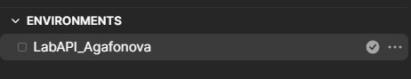

Создала коллекцию LabAPI_Agafonova и привязала к ней окружение. Внутри коллекции создала папки: Auth, Booking, Health.

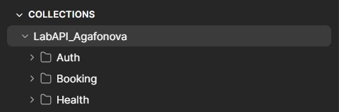

### Задание 2. Добавьте запросы **ко всем эндпоинтам** из таблицы. Для каждого запроса напишите описание: цель, входные данные, ожидаемый результат.

#### Таблица запросов к эндпоинтам
| ID | Папка / Метод | URL | Заголовки (Headers) | Тело запроса (Body) | Текст для вкладки Docs (Description) |
|---|---|---|---|---|---|
| 1 | **Health** GET | `{{baseUrl}}/ping` | — | — | **Цель:** Проверка работоспособности сервера. **Входные данные:** Нет. **Ожидаемый результат:** Код 201, текст "Created", время ответа < 2000 мс. |
| 2 | **Auth** POST | `{{baseUrl}}/auth` | — | `{"username": "admin", "password": "password123"}` | **Цель:** Получение токена авторизации для доступа к защищенным методам. **Входные данные:** JSON с логином `admin` и паролем `password123`. **Ожидаемый результат:** Код 200, в ответе JSON с полем `token`. Скрипт сохраняет токен в переменную окружения. |
| 3 | **Booking** POST | `{{baseUrl}}/booking` | — | `{"firstname": "Jim", "lastname": "Brown", "totalprice": 111, "depositpaid": true, "bookingdates": {"checkin": "2024-01-01", "checkout": "2024-01-05"}, "additionalneeds": "Breakfast"}` | **Цель:** Создание нового бронирования отеля. **Входные данные:** JSON с данными гостя (имя, фамилия, цена, даты и т.д.). **Ожидаемый результат:** Код 200, в ответе JSON с полем `bookingid`. Скрипт сохраняет ID в переменную окружения. |
| 4 | **Booking** GET | `{{baseUrl}}/booking/{{bookingId}}` | — | — | **Цель:** Получение информации о созданном бронировании по его ID. **Входные данные:** ID бронирования из переменной `{{bookingId}}`. **Ожидаемый результат:** Код 200, JSON с данными созданного ранее бронирования. |
| 5 | **Booking** PUT | `{{baseUrl}}/booking/{{bookingId}}` | `Cookie: token={{token}}` | `{"firstname": "James", "lastname": "Brown", "totalprice": 111, "depositpaid": true, "bookingdates": {"checkin": "2024-01-01", "checkout": "2024-01-05"}, "additionalneeds": "Breakfast"}` | **Цель:** Полное обновление данных бронирования. **Входные данные:** ID бронирования (`{{bookingId}}`), токен в Cookie, новый JSON с измененным именем (James). **Ожидаемый результат:** Код 200, JSON с обновленными данными (имя James). |
| 6 | **Booking** PATCH | `{{baseUrl}}/booking/{{bookingId}}` | `Cookie: token={{token}}` | `{"totalprice": 222}` | **Цель:** Частичное обновление (изменение только цены). **Входные данные:** ID бронирования, токен в Cookie, JSON с новой ценой (`totalprice`). **Ожидаемый результат:** Код 200, JSON с обновленной ценой, остальные поля не изменились. |
| 7 | **Booking** DELETE | `{{baseUrl}}/booking/{{bookingId}}` | `Cookie: token={{token}}` | — | **Цель:** Удаление бронирования. **Входные данные:** ID бронирования, токен в Cookie. **Ожидаемый результат:** Код 201 (особенность API Restful-Booker). |
| 8 | **Booking** GET | `{{baseUrl}}/booking/{{bookingId}}` | — | — | **Цель:** Проверка, что бронирование действительно удалено. **Входные данные:** ID удаленного бронирования. **Ожидаемый результат:** Код 404 (Not Found). |

Создала все запросы из таблицы в коллекции `LabAPI_Agafonova`.

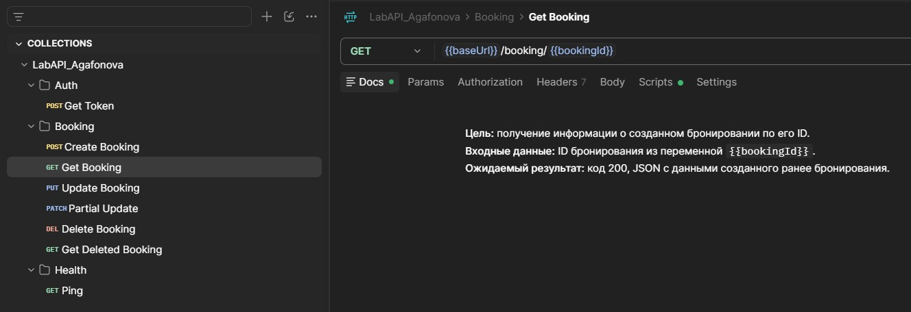

### Задание 3. Автоматизируйте получение токена. В запросе `POST /auth` скриптом во вкладке Tests сохраните токен в переменную окружения. В запросе создания бронирования сохраните `bookingid`.

Написала скрипт в запросе `POST /auth`, который сохраняет токен в переменную окружения.

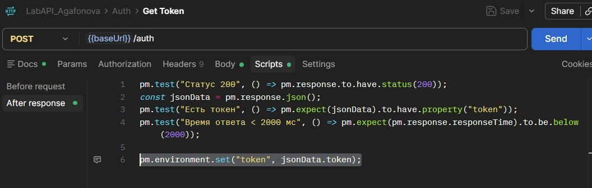

Написала скрипт в запросе `POST /booking`, который сохраняет `bookingid`.

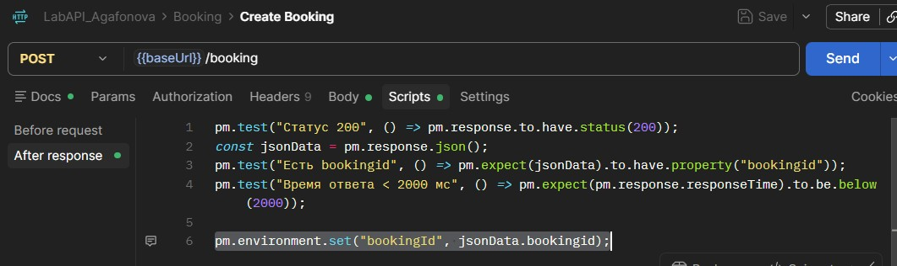

Проверила переменные окружения `LabAPI_Agafonova` после выполнения скриптов.

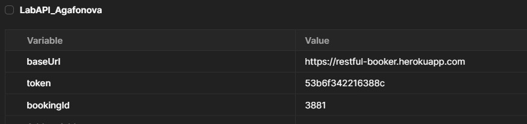

### Задание 4. Составьте и выполните тест-кейсы в каждой категории: позитивные, негативные, граничные значения.

#### Таблица тест-кейсов

| ID | Категория | Метод и Путь | Входные данные (Body / Headers) | Ожидаемый результат | Фактический результат | Статус |
|---|---|---|---|---|---|---|
| TC-01 | Позитивный | `POST {{baseUrl}}/auth` | `{"username":"admin", "password":"password123"}` | 200 OK. Успешная авторизация, в ответе есть token. | Совпал с ожидаемым | **PASS** |
| TC-02 | Позитивный | `POST {{baseUrl}}/booking` | Полный валидный JSON (firstname, lastname, totalprice, depositpaid, bookingdates). | 200 OK. Создание брони, в ответе есть bookingid. | Совпал с ожидаемым | **PASS** |
| TC-03 | Позитивный | `GET {{baseUrl}}/booking/{{bookingId}}` | — | 200 OK. Получение данных созданной брони. | Совпал с ожидаемым | **PASS** |
| TC-04 | Позитивный | `PUT {{baseUrl}}/booking/{{bookingId}}` | Headers: `Cookie: token={{token}}` Body: полный валидный JSON. | 200 OK. Полное обновление данных. | Совпал с ожидаемым | **PASS** |
| TC-05 | Позитивный | `PATCH {{baseUrl}}/booking/{{bookingId}}` | Headers: `Cookie: token={{token}}` Body: `{"totalprice": 222}` | 200 OK. Частичное обновление (изменена цена). | Совпал с ожидаемым | **PASS** |
| TC-06 | Позитивный | `DELETE {{baseUrl}}/booking/{{bookingId}}` | Headers: `Cookie: token={{token}}` | 201 Created. Удаление брони. | Совпал с ожидаемым | **PASS** |
| TC-07 | Позитивный | `GET {{baseUrl}}/booking/{{bookingId}}` | — (ID удаленной брони) | 404 Not Found. Ошибка, так как бронь удалена. | Совпал с ожидаемым | **PASS** |
| TC-08 | Негативный | `POST {{baseUrl}}/auth` | `{"username":"admin", "password":"wrong"}` | 401 Unauthorized. Отказ в доступе (неверный пароль). | Не совпал. Код **200 OK** (в теле `reason: Bad credentials`). | **FAIL** |
| TC-09 | Негативный | `DELETE {{baseUrl}}/booking/1` | Без заголовка Cookie. | 403 Forbidden. Запрещено (нет токена). | Совпал с ожидаемым | **PASS** |
| TC-10 | Негативный | `DELETE {{baseUrl}}/booking/1` | Headers: `Cookie: token=invalid_token` | 403 Forbidden. Запрещено (неверный токен). | Совпал с ожидаемым | **PASS** |
| TC-11 | Негативный | `GET {{baseUrl}}/booking/999999` | — | 404 Not Found. Бронь не найдена. | Совпал с ожидаемым | **PASS** |
| TC-12 | Негативный | `POST {{baseUrl}}/booking` | `{"firstname": "Jim", (сломанный JSON)` | 400 Bad Request. Ошибка валидации JSON. | Совпал с ожидаемым | **PASS** |
| TC-13 | Негативный | `POST {{baseUrl}}/booking` | `"totalprice": "пятьсот"` (строка вместо числа). | 400 Bad Request. Ошибка типа данных. | Не совпал. Код **200 OK** (в ответе `totalprice: null`). | **FAIL** |
| TC-14 | Негативный | `POST {{baseUrl}}/booking` | Только `{"firstname": "Jim"}` (нет дат и других полей). | 400 Bad Request. Ошибка отсутствия обязательных полей. | Не совпал. Код **500 Internal Server Error**. | **FAIL** |
| TC-15 | Граничный | `POST {{baseUrl}}/booking` | `"firstname": ""` (пустая строка). | 400 Bad Request. Ошибка валидации (поле не может быть пустым). | Не совпал. Код **200 OK**. | **FAIL** |
| TC-16 | Граничный | `POST {{baseUrl}}/booking` | `"firstname": "D...D"` (1000+ символов). | 400 Bad Request. Ошибка (превышена длина строки). | Не совпал. Код **413 Request Entity Too Large**. | **FAIL** |
| TC-17 | Граничный | `POST {{baseUrl}}/booking` | `"totalprice": 0` | 400 Bad Request. Ошибка (цена не может быть 0). | Не совпал. Код **200 OK**. | **FAIL** |
| TC-18 | Граничный | `POST {{baseUrl}}/booking` | `"totalprice": -111` | 400 Bad Request. Ошибка (отрицательная цена). | Не совпал. Код **200 OK**. | **FAIL** |
| TC-19 | Граничный | `POST {{baseUrl}}/booking` | `"totalprice": 111111111111111` | 400 Bad Request. Ошибка (слишком большое число). | Не совпал. Код **200 OK**. | **FAIL** |
| TC-20 | Граничный | `POST {{baseUrl}}/booking` | `"checkin": "2024-01-10", "checkout": "2024-01-01"` | 400 Bad Request. Ошибка (дата выезда раньше даты заезда). | Не совпал. Код **200 OK**. | **FAIL** |
| TC-21 | Граничный | `POST {{baseUrl}}/booking` | `"checkin": "20-01-2035"` (невалидный формат). | 400 Bad Request. Ошибка формата даты. | Не совпал. Код **200 OK**. | **FAIL** |

Ниже приведены скриншоты, подтверждающие выявленные дефекты из таблицы.

**TC-07. Позитивный сценарий (Collection Runner)**

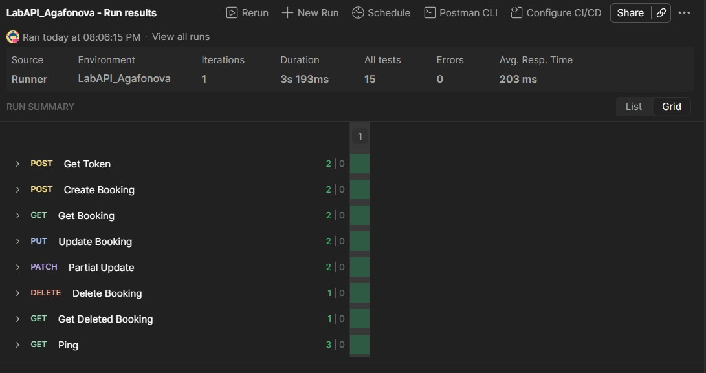

**TC-08. Отсутствие проверки учетных данных**

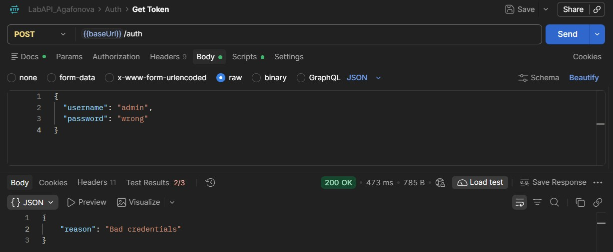

**TC-09. Запрос без токена**

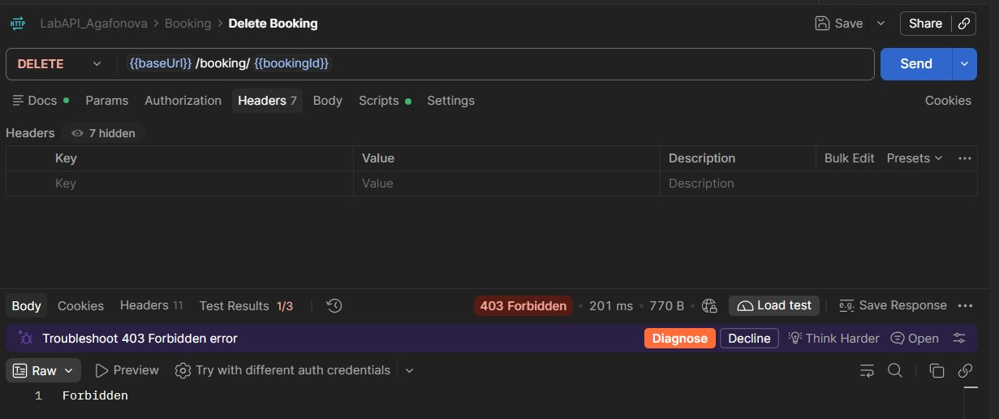

**TC-10. Запрос с некорректным токеном**

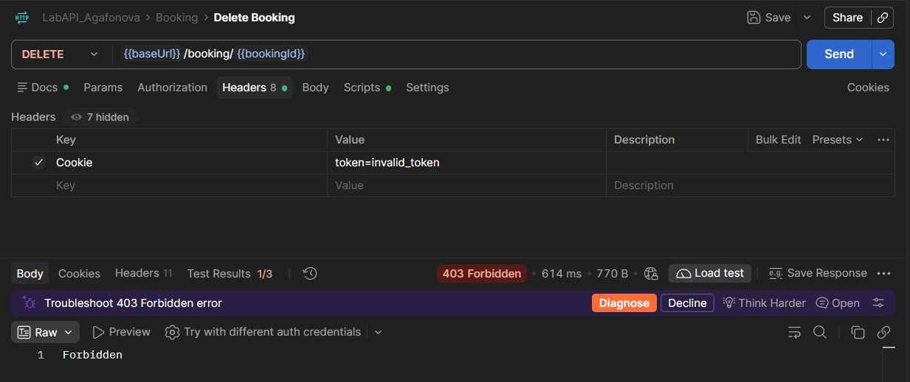

**TC-11. Несуществующий ID**

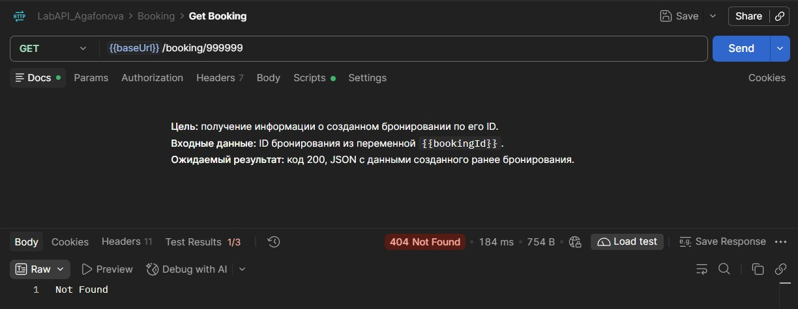

**TC-12. Некорректный JSON**

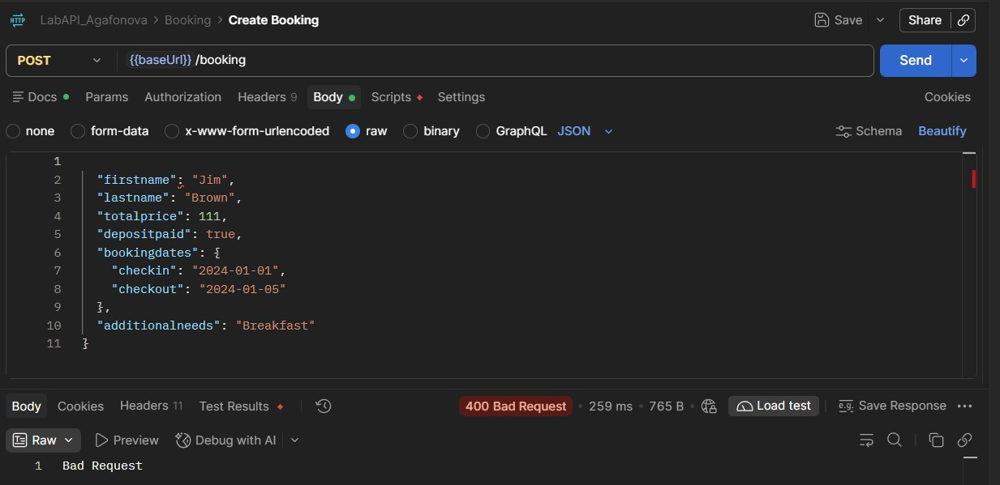

**TC-13. Отсутствие строгой типизации**

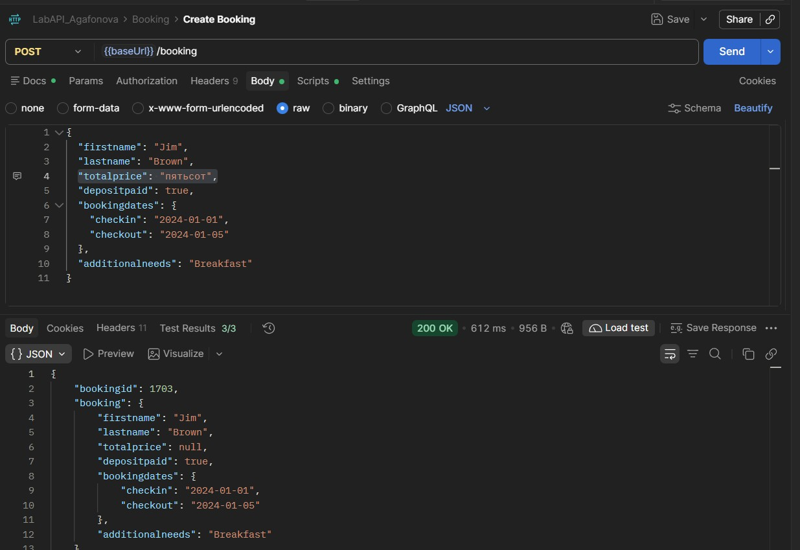

**TC-14. Необработанное исключение (500)**

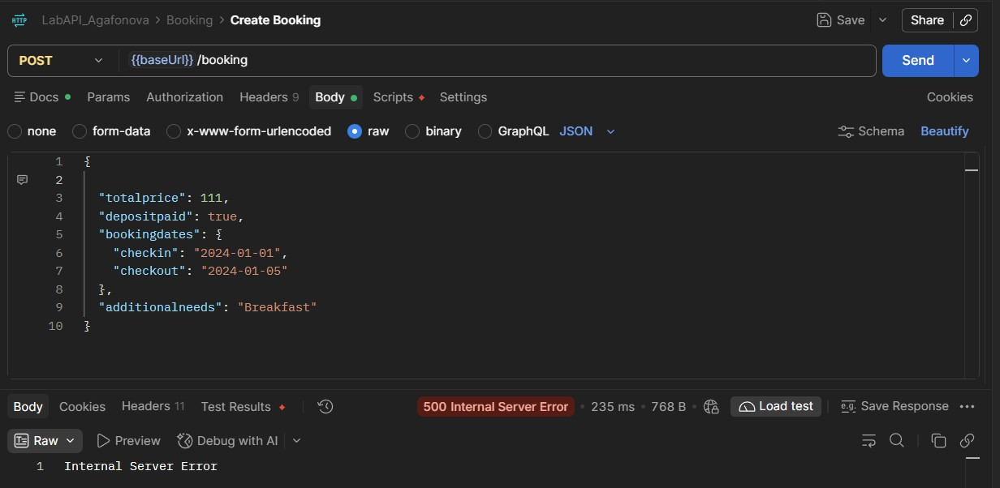

**TC-15. Отсутствие семантической валидации**

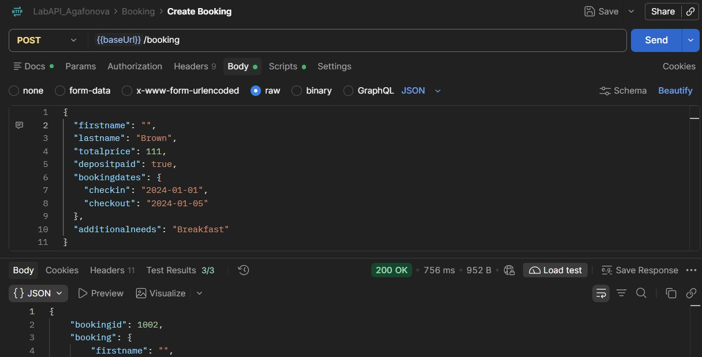

**TC-16. Игнорирование ограничений длины**

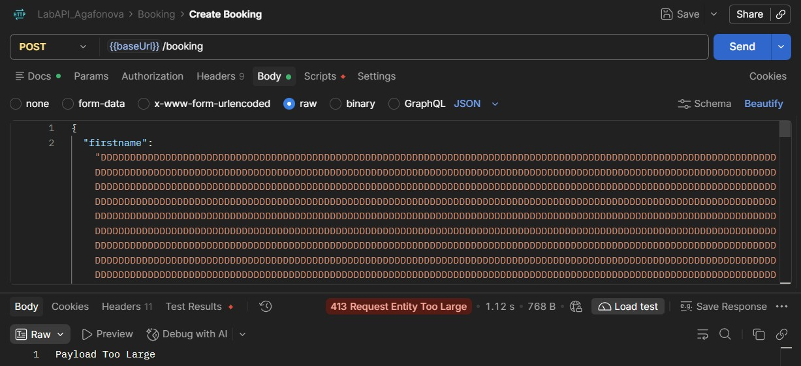

**TC-17. Нарушение бизнес-правил (цена 0)**

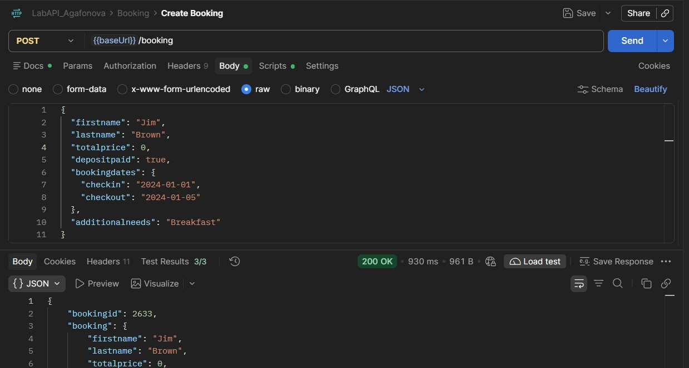

**TC-18. Отсутствие проверки диапазона значений**

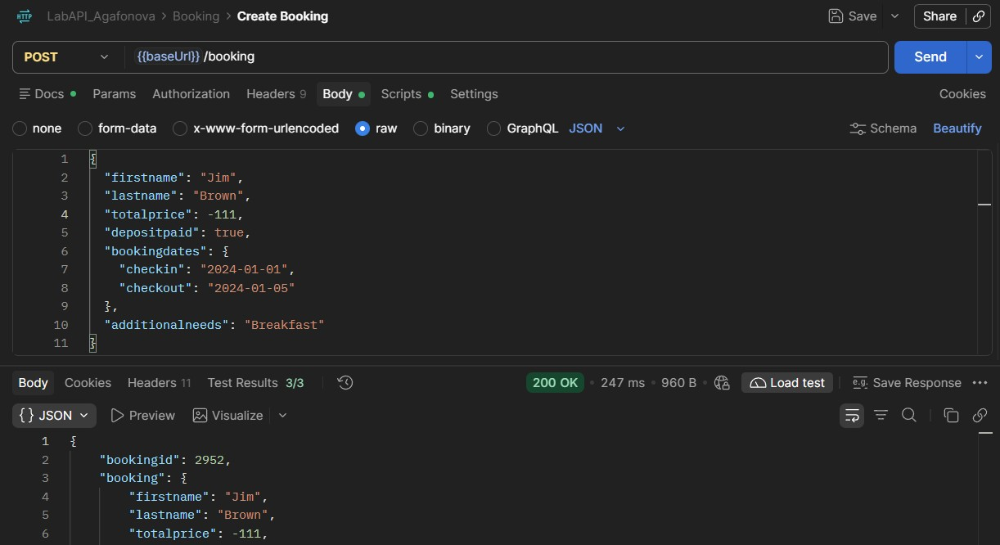

**TC-19. Отсутствие проверки переполнения**

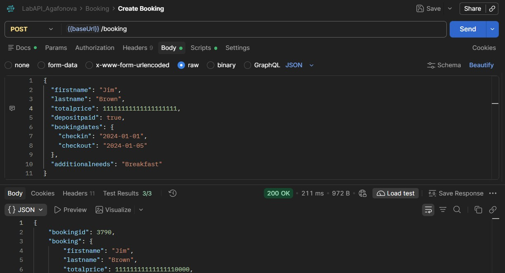

**TC-20. Нарушение логики дат**

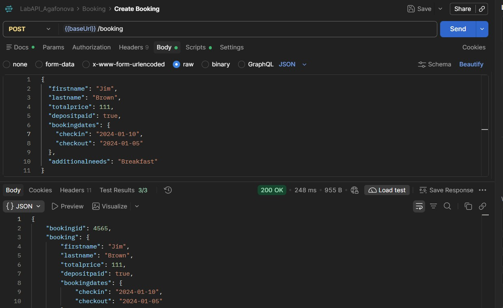

**TC-21. Отсутствие проверки формата**

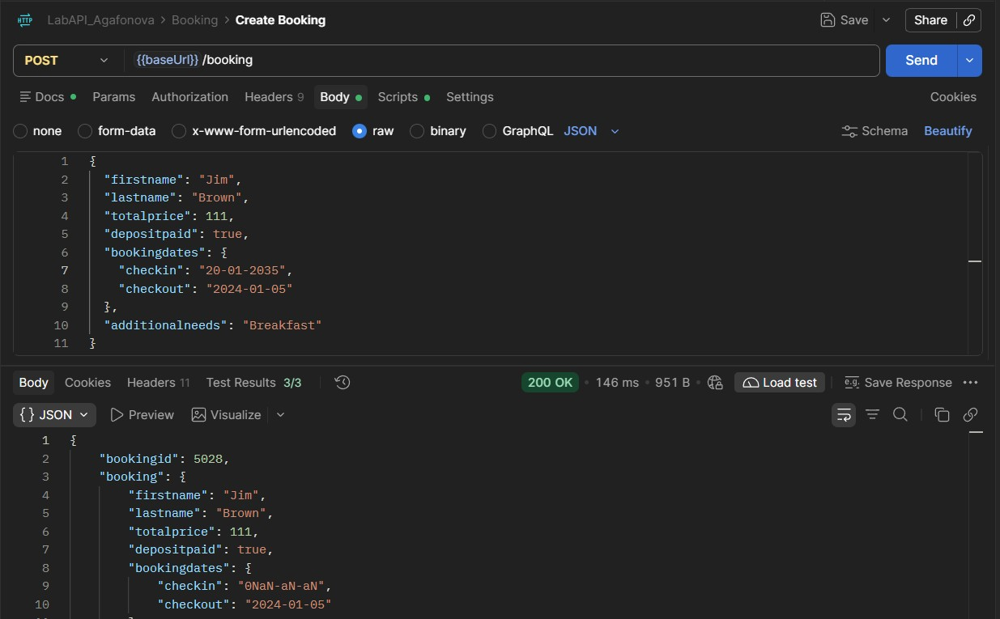

### Задание 5. Для каждого запроса добавьте во вкладку Tests минимум 3 автоматические проверки.

Для автоматической валидации ответов API во всех запросах коллекции были добавлены скрипты на вкладке **Scripts**. Скрипты разделены по типам тестов.

**Пример проверок для запроса создания бронирования:**

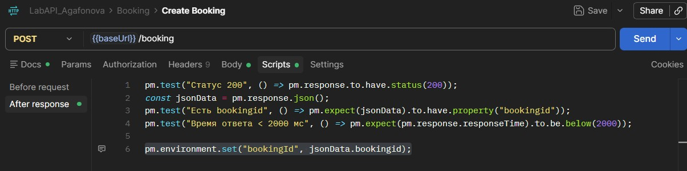

### Задание 6. Запустите всю коллекцию через **Collection Runner** и убедитесь, что цепочка сценариев работает без ручного вмешательства (токен и `id` передаются через переменные).

Для проверки работоспособности всей цепочки сценариев без ручного вмешательства коллекция `LabAPI_Agafonova` была запущена через Collection Runner с выбранным окружением `LabAPI_Agafonova`.

По общим результатам прогона видно, что было выполнено 24 проверки за 3,94 секунд. Успешно пройдено — 24, провалено — 0. Ошибок уровня скриптов — 0. 

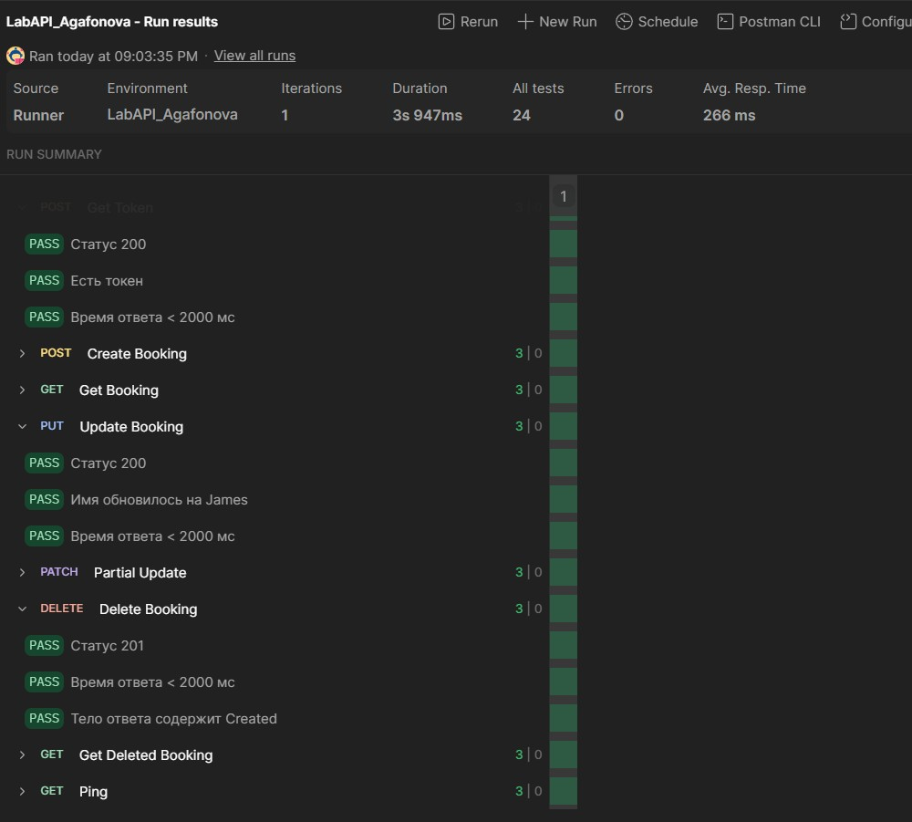

Переменные `token` и `bookingId` автоматически извлекаются из ответов запросов `POST /auth` и `POST /booking` с помощью скриптов и корректно подставляются в URL, что исключает необходимость ручного вмешательства.

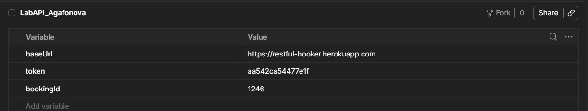

### Задание 7. **Фактическое и ожидаемое поведение.** Это публичное учебное API, и его реальное поведение может отличаться от документации и от «правильного» REST (нестандартные коды для ошибок, код ответа для DELETE и т. д.). Оформите таблицу расхождений.

#### Таблица расхождений

| № | Запрос | Ожидалось (по REST/документации) | Получено | Вывод (дефект / особенность) |
|---|---|---|---|---|
| 1 | TC-08 `POST /auth` (неверный пароль) | 401 Unauthorized | 200 OK | **Дефект.** API возвращает код успешного выполнения при неверных учетных данных, перекладывая обработку ошибки на клиент (в теле `reason: Bad credentials`). |
| 2 | TC-13 `POST /booking` (`"totalprice": "пятьсот"`) | 400 Bad Request | 200 OK | **Дефект.** Отсутствует валидация типов данных. Строка принимается вместо числа (в ответе `totalprice: null`). |
| 3 | TC-14 `POST /booking` (без обязательных полей) | 400 Bad Request | 500 Internal Server Error | **Дефект.** Необработанное исключение сервера (падение) вместо корректной ошибки клиента. |
| 4 | TC-15 `POST /booking` (пустая строка в имени) | 400 Bad Request | 200 OK | **Дефект.** API принимает пустые значения обязательных полей. |
| 5 | TC-16 `POST /booking` (1000+ символов в имени) | 400 Bad Request | 413 Request Entity Too Large | **Особенность.** Сервер имеет защиту от переполнения, но возвращает нестандартный код для ошибки валидации (вместо 400). |
| 6 | TC-17 `POST /booking` (`"totalprice": 0`) | 400 Bad Request | 200 OK | **Дефект.** API пропускает нулевую стоимость. |
| 7 | TC-18 `POST /booking` (`"totalprice": -111`) | 400 Bad Request | 200 OK | **Дефект.** API пропускает отрицательную стоимость. |
| 8 | TC-19 `POST /booking` (`"totalprice": 111111111111111`) | 400 Bad Request | 200 OK | **Дефект.** Отсутствует ограничение на максимально допустимое число. |
| 9 | TC-20 `POST /booking` (дата выезда раньше заезда) | 400 Bad Request | 200 OK | **Дефект.** Отсутствует логическая валидация дат. |
| 10 | TC-21 `POST /booking` (невалидный формат даты) | 400 Bad Request | 200 OK | **Дефект.** Сервер принимает даты в неверном формате. |
| 11 | TC-03 `POST /booking` (успешное создание) | 201 Created | 200 OK | **Особенность.** При успешном создании ресурса API возвращает 200, а не 201 по стандарту REST. |
| 12 | TC-06 `DELETE /booking/{{bookingId}}` (успешное удаление) | 204 No Content | 201 Created | **Особенность.** API возвращает 201 при удалении, что не соответствует стандарту REST (ожидается 204 без тела). |

#### Список найденных дефектов (Баг-репорты)

##### 1: API возвращает код 200 при неверном пароле
- **Тест-кейс:** TC-08
- **Серьёзность:** High
- **Шаги воспроизведения:** Отправить `POST /auth` с телом `{"username": "admin", "password": "wrong"}`.
- **Ожидаемый результат:** Код `401 Unauthorized`.
- **Фактический результат:** Код `200 OK`. В теле ответа возвращается JSON с ошибкой `"reason": "Bad credentials"`.

##### 2: Сервер падает (500) при отсутствии обязательных полей
- **Тест-кейс:** TC-14
- **Серьёзность:** Critical
- **Шаги воспроизведения:** Отправить `POST /booking` с телом `{"firstname": "Jim"}`.
- **Ожидаемый результат:** Код `400 Bad Request`.
- **Фактический результат:** Код `500 Internal Server Error`.

##### 3: Отсутствует валидация типов данных
- **Тест-кейс:** TC-13
- **Серьёзность:** Medium
- **Шаги воспроизведения:** Отправить `POST /booking` с `"totalprice": "пятьсот"`.
- **Ожидаемый результат:** Код `400 Bad Request`.
- **Фактический результат:** Код `200 OK`. Бронь создается, в ответе `totalprice: null`.

##### 4: API принимает пустые значения обязательных полей
- **Тест-кейс:** TC-15
- **Серьёзность:** Medium
- **Шаги воспроизведения:** Отправить `POST /booking` с `"firstname": ""`.
- **Ожидаемый результат:** Код `400 Bad Request`.
- **Фактический результат:** Код `200 OK`. Бронь создана с пустым именем.

##### 5: Нарушение бизнес-логики (нулевая и отрицательная стоимость)
- **Тест-кейсы:** TC-17, TC-18
- **Серьёзность:** High
- **Шаги воспроизведения:** Отправить `POST /booking` с `"totalprice": 0` или `"totalprice": -100`.
- **Ожидаемый результат:** Код `400 Bad Request`.
- **Фактический результат:** Код `200 OK`. Бронирование успешно создается.

##### 6: Нарушение логики дат
- **Тест-кейсы:** TC-20, TC-21
- **Серьёзность:** High
- **Шаги воспроизведения:** Отправить `POST /booking` с датой выезда раньше даты заезда или в неверном формате (DD-MM-YYYY).
- **Ожидаемый результат:** Код `400 Bad Request`.
- **Фактический результат:** Код `200 OK`. Бронь создана.

### Экспортированные файлы коллекции и окружения (JSON).

К отчету прилагаются файлы, экспортированные из Postman:
* `LabAPI_Agafonova.postman_collection.json` — файл коллекции с запросами и скриптами.
* `LabAPI_Agafonova.postman_environment.json` — файл окружения с переменными.

Оба файла находятся в корневой папке проекта (`lab_2`). Для проверки работы коллекции достаточно импортировать их в Postman (File -> Import).

### Выводы

В ходе выполнения лабораторной работы было освоено тестирование REST API с использованием Postman. Была успешно создана коллекция с автоматическими проверками и настроена передача переменных (`token` и `bookingId`) между запросами, что позволило полностью автоматизировать сценарии без ручного вмешательства. 

В результате негативного и граничного тестирования были выявлены существенные дефекты на стороне сервера: API возвращает код успеха 200 OK при неверных учетных данных и полностью игнорирует валидацию типов данных, логику дат и допустимые границы значений. Также при отсутствии обязательных полей сервер падает с ошибкой 500 Internal Server Error, что подтверждает необходимость доработки механизмов обработки исключений и валидации входных данных.