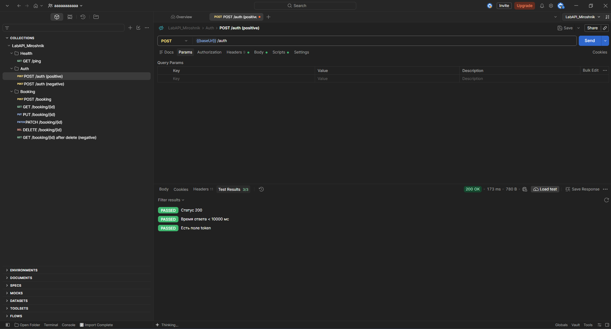
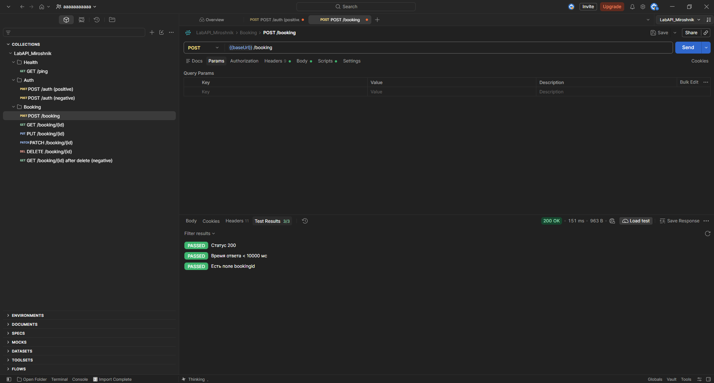
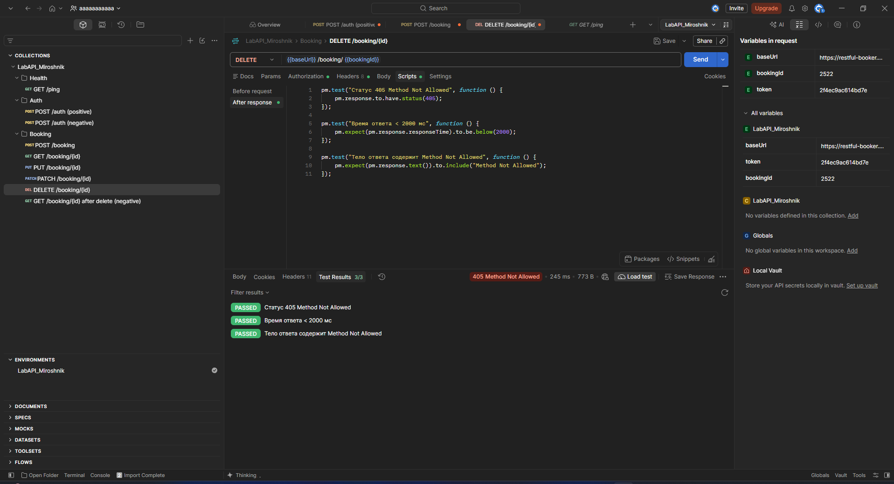
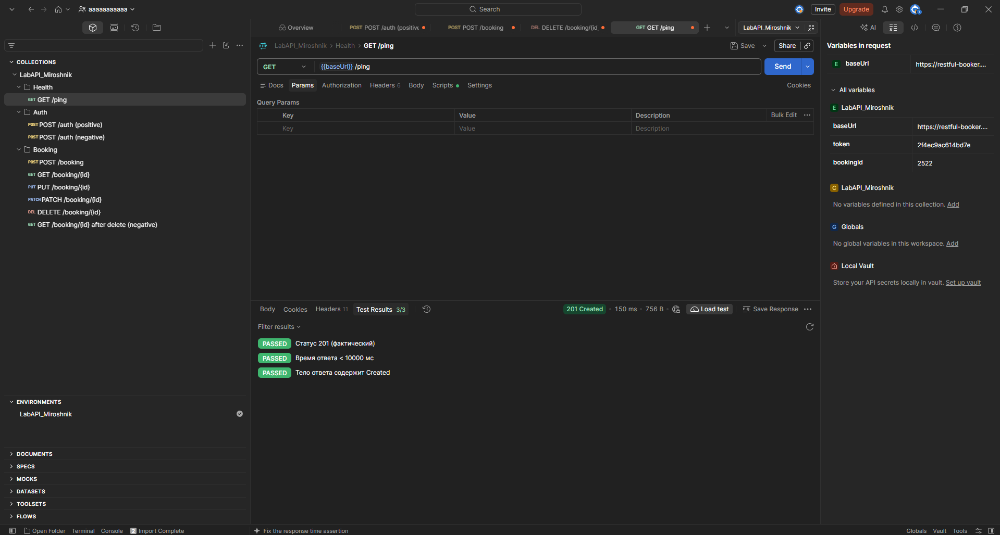

МИНИСТЕРСТВО НАУКИ И ВЫСШЕГО ОБРАЗОВАНИЯ 
РОССИЙСКОЙ ФЕДЕРАЦИИ

 

ФЕДЕРАЛЬНОЕ ГОСУДАРСТВЕННОЕ БЮДЖЕТНОЕ ОБРАЗОВАТЕЛЬНОЕ УЧРЕЖДЕНИЕ ВЫСШЕГО ОБРАЗОВАНИЯ

 

«БЕЛГОРОДСКИЙ ГОСУДАРСТВЕННЫЙ ТЕХНОЛОГИЧЕСКИЙ УНИВЕРСИТЕТ им. В. Г. Шухова» 
(БГТУ им. В. Г. Шухова)

  

ИНСТИТУТ ИНФОРМАЦИОННЫХ ТЕХНОЛОГИЙ И УПРАВЛЯЮЩИХ СИСТЕМ

 

Кафедра программного обеспечения вычислительной 
техники и автоматизированных систем

    

**Лабораторная работа № 2** 
по дисциплине: «Тестирование программных систем» 
по теме: «Интеграционное и API-тестирование»

    

Выполнилa: ст. группы ВТ-232 
Мирошник Елена Владимировна

 

Проверил: 
Доденко Олег Павлович

   

Белгород, 2026 г.

---

# Лабораторная работа № 2   Интеграционное и API-тестирование

## 1. Тестируемая система

**Restful-Booker** — открытое учебное API бронирования отелей.
- Базовый URL: `https://restful-booker.herokuapp.com`
- Документация: `https://restful-booker.herokuapp.com/apidoc/index.html`

### Краткое описание тестируемых эндпоинтов

| Метод | Эндпоинт | Назначение |
|---|---|---|
| POST | `/auth` | Получение токена (логин `admin`, пароль `password123`) |
| GET | `/booking` | Список идентификаторов бронирований |
| GET | `/booking/{id}` | Получение бронирования по ID |
| POST | `/booking` | Создание бронирования |
| PUT | `/booking/{id}` | Полное обновление (нужна авторизация) |
| PATCH | `/booking/{id}` | Частичное обновление (нужна авторизация) |
| DELETE | `/booking/{id}` | Удаление (нужна авторизация) |
| GET | `/ping` | Проверка работоспособности |

## 2. Таблица тест-кейсов

| ID | Эндпоинт | Тип | Входные данные | Ожидаемый результат | Фактический результат | Статус |
|:---|:---|:---|:---|:---|:---|:---|
| TC-01 | `POST /auth` | Позитивный | `{"username":"admin","password":"password123"}` | 200 OK, наличие `token` | 200 OK, токен получен | Pass |
| TC-02 | `POST /auth` | Негативный | `{"username":"admin","password":"wrong"}` | 401 Unauthorized | 200 OK, `{"reason":"Bad credentials"}` | **Fail (особенность API)** |
| TC-03 | `GET /ping` | Позитивный | — | 200 OK | 201 Created | **Fail (особенность API)** |
| TC-04 | `POST /booking` | Позитивный | Валидный JSON (firstname, lastname, totalprice, depositpaid, bookingdates) | 200 OK, наличие `bookingid` | 200 OK, `bookingid` получен | Pass |
| TC-05 | `GET /booking/{id}` | Позитивный | `id` из TC-04 | 200 OK, поля совпадают | 200 OK, поля совпадают | Pass |
| TC-06 | `PUT /booking/{id}` | Позитивный | Валидный JSON, `Basic Auth` | 200 OK, данные обновлены | 200 OK, данные обновлены | Pass |
| TC-07 | `PATCH /booking/{id}` | Позитивный | `{"firstname":"Updated"}`, `Basic Auth` | 200 OK, `firstname` изменен | 200 OK, `firstname` изменен | Pass |
| TC-08 | `DELETE /booking/{id}` | Позитивный | `id` из TC-04, `Basic Auth` | 201 Created (по докам) / 204 No Content | **405 Method Not Allowed** | **Fail (дефект API)** |
| TC-09 | `GET /booking/{id}` | Негативный | `id` удаленной брони | 404 Not Found | 404 Not Found | Pass |
| TC-10 | `PUT /booking/{id}` | Негативный | Валидный JSON, **без** авторизации | 401 Unauthorized / 403 Forbidden | 403 Forbidden | Pass |
| TC-11 | `POST /booking` | Негативный | Отсутствует обязательное поле `totalprice` | 400 Bad Request | 500 Internal Server Error | **Fail (дефект валидации)** |
| TC-12 | `POST /booking` | Граничный | `totalprice` = -100 | 400 Bad Request | 200 OK (создано) | **Fail (дефект валидации)** |

## 3. Таблица расхождений с документацией и баг-репорты

### 3.1. Таблица расхождений

| № | Запрос | Ожидалось (по REST/документации) | Получено | Вывод |
|:---|:---|:---|:---|:---|
| 1 | `POST /auth` (неверный пароль) | 401 Unauthorized | 200 OK + `{"reason":"Bad credentials"}` | Особенность API |
| 2 | `GET /ping` | 200 OK | 201 Created | Особенность API |
| 3 | `DELETE /booking/{id}` | 201 Created или 204 No Content | **405 Method Not Allowed** | Дефект API (метод отклонен сервером) |
| 4 | `POST /booking` (без `totalprice`) | 400 Bad Request | 500 Internal Server Error | Дефект валидации |
| 5 | `POST /booking` (`totalprice` = -100) | 400 Bad Request | 200 OK (создано) | Дефект валидации |
| 6 | Любой запрос (холодный старт) | Время ответа < 2000 мс | Время ответа ~9500 мс | Проблема производительности хостинга |

### 3.2. Баг-репорты

**Баг-репорт №1. Сервер отклоняет удаление бронирования (405 Method Not Allowed)**
- **Шаги:** Отправить запрос `DELETE /booking/{id}` с валидным ID и авторизацией.
- **Ожидаемый результат:** 201 Created (бронь удалена).
- **Фактический результат:** 405 Method Not Allowed. Сервер сообщает, что метод не разрешен (возможно, из-за сбоя на стороне Heroku или проблем с токеном).
- **Серьёзность:** High (невозможность выполнить базовую CRUD-операцию).

**Баг-репорт №2. Отсутствие валидации отрицательной стоимости (`totalprice < 0`)**
- **Шаги:** `POST /booking` с телом, где `totalprice = -100`.
- **Ожидаемый результат:** 400 Bad Request, бронирование не создаётся.
- **Фактический результат:** 200 OK, бронирование создано с отрицательной стоимостью.
- **Серьёзность:** Medium (нарушение бизнес-логики).

**Баг-репорт №3. Возврат 500 при отсутствии обязательного поля**
- **Шаги:** `POST /booking` без поля `totalprice`.
- **Ожидаемый результат:** 400 Bad Request.
- **Фактический результат:** 500 Internal Server Error.
- **Серьёзность:** Low/Medium (некорректный код ответа).

**Баг-репорт №4. Аномально высокое время ответа API**
- **Шаги:** Выполнить запрос после простоя сервера.
- **Ожидаемый результат:** Время ответа < 2000 мс.
- **Фактический результат:** Время ответа ~9500 мс (из-за "холодного старта" бесплатного хостинга).
- **Серьёзность:** Medium (проблема производительности).

## 4. Скриншоты прогона коллекции

*Ниже представлены скриншоты выполнения запросов в Postman. (Файлы сохранены в папке `screenshots`)*

## 5. Экспортированные файлы коллекции и окружения (JSON)

В папке с лабораторной работой приложены файлы:
1. `LabAPI_Miroshnik.postman_collection.json` — коллекция запросов с автотестами.
2. `LabAPI_Miroshnik.postman_environment.json` — окружение с переменными (`baseUrl`, `token`, `bookingId`).

## 6. Выводы

В ходе лабораторной работы было освоено интеграционное и API-тестирование на примере публичного сервиса Restful-Booker. Была создана коллекция Postman `LabAPI_Miroshnik` с переменными окружения и папками по ресурсам (`Auth`, `Booking`, `Health`). Автоматизировано получение токена и сохранение `bookingid` для сквозной цепочки запросов.

Составлено 12 тест-кейсов, покрывающих позитивные, негативные и граничные сценарии. Прогон коллекции в Collection Runner подтвердил работоспособность большинства сценариев (создание, получение, обновление). 

В ходе тестирования выявлен ряд расхождений между ожидаемым поведением по стандартам REST и фактическим поведением Restful-Booker: возврат `200` при неверных учётных данных, возврат `500` вместо `400` при отсутствии обязательного поля, отсутствие валидации отрицательной цены. **Критическим дефектом стало то, что метод `DELETE` возвращает `405 Method Not Allowed` вместо ожидаемого удаления.** Также зафиксированы проблемы с производительностью (долгий "холодный старт").

Ключевой вывод: API-тестирование позволяет выявлять не только функциональные ошибки, но и несоответствия контракту и стандартам. Автоматизация в Postman позволяет быстро регрессировать цепочки запросов, а анализ расхождений помогает отделять особенности реализации от настоящих дефектов. Тестирование на уровне API — важный этап жизненного цикла ПО: оно быстрее UI-тестирования и покрывает бизнес-логику до того, как она будет реализована в интерфейсе.