# Лабораторная работа № 2 «Интеграционное и API-тестирование»

**Выполнила:** Жаворонкова Дарья  
**Группа:** ВТ-232  

## Цель

Освоить тестирование REST API на примере открытого публичного сервиса: научиться строить в Postman коллекцию запросов, писать автоматические проверки и анализировать расхождения между документацией и фактическим поведением API.

## Тестируемая система

**Restful-Booker**, открытое учебное API бронирования отелей: https://restful-booker.herokuapp.com (документация: https://restful-booker.herokuapp.com/apidoc/index.html). Docker и локальный запуск не нужны, достаточно Postman и доступа в интернет.

| Метод | Эндпоинт | Назначение |
|---|---|---|
| POST | `/auth` | получение токена (логин `admin`, пароль `password123`) |
| GET | `/booking` | список идентификаторов бронирований (с фильтрами) |
| GET | `/booking/{id}` | получение бронирования |
| POST | `/booking` | создание бронирования |
| PUT | `/booking/{id}` | полное обновление (нужна авторизация) |
| PATCH | `/booking/{id}` | частичное обновление (нужна авторизация) |
| DELETE | `/booking/{id}` | удаление (нужна авторизация) |
| GET | `/ping` | проверка работоспособности |


## Выполнение заданий:

## Задание 1. Создайте в Postman коллекцию `LabAPI_<Фамилия>` с переменными окружения (`baseUrl`, `token`, `bookingId`) и папками по ресурсам: `Auth`, `Booking`, `Health`.
Создала новое Environment с переменными.

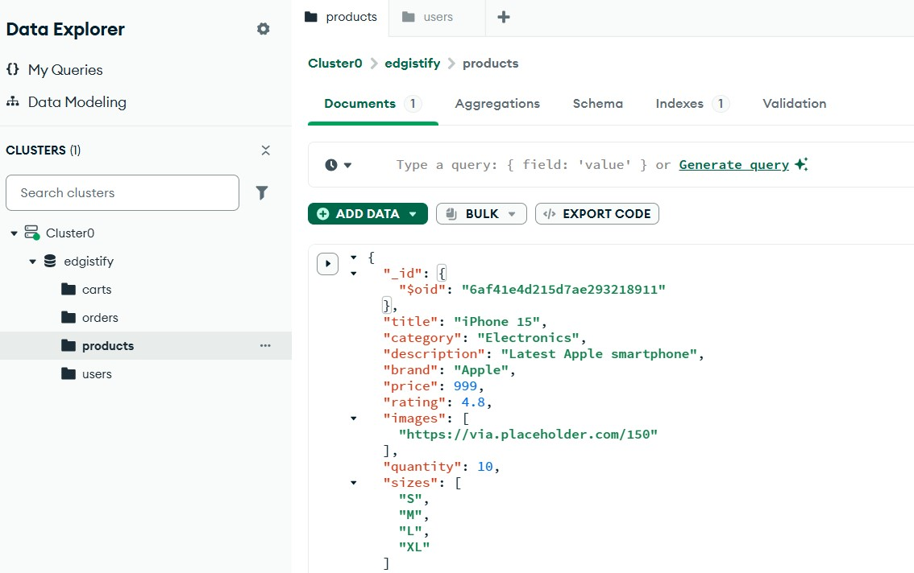

Создала коллекцию LabAPI_Zhavoronkova и привязала к ней окружение.

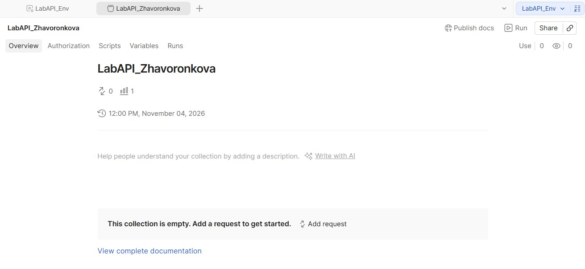

Внутри коллекции создала папки: Auth, Booking, Health.

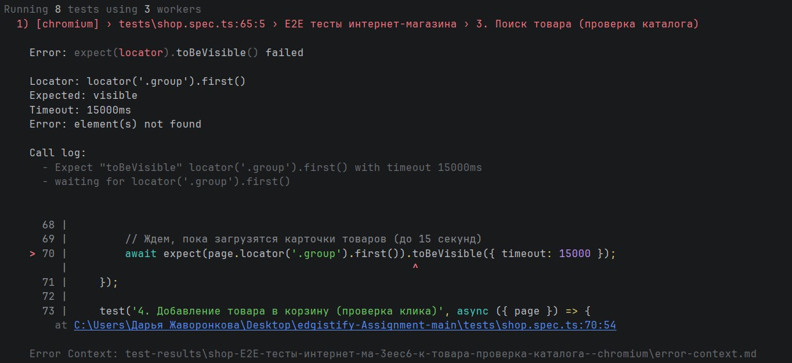

## Задание 2. Добавьте запросы **ко всем эндпоинтам** из таблицы. Для каждого запроса напишите описание: цель, входные данные, ожидаемый результат.
### Таблица запросов к эндпоинтам

| ID | Папка / Метод | URL | Заголовки (Headers) | Тело запроса (Body) | Текст для вкладки Docs (Description) |
|---|---|---|---|---|---|
| TC-01 | **Auth**<br>POST | `{{baseUrl}}/auth` | — | `{"username":"admin", "password":"password123"}` | **Цель:** Получение токена авторизации.<br>**Входные данные:** username=admin, password=password123.<br>**Ожидаемый результат:** Код 200, наличие поля token. |
| TC-02 | **Health**<br>GET | `{{baseUrl}}/ping` | — | — | **Цель:** Проверка доступности сервиса.<br>**Входные данные:** нет.<br>**Ожидаемый результат:** Код 200. |
| TC-03 | **Booking**<br>POST | `{{baseUrl}}/booking` | — | `{"firstname": "Jim", "lastname": "Brown", "totalprice": 111, "depositpaid": true, "bookingdates": {"checkin": "2024-01-01", "checkout": "2024-01-05"}, "additionalneeds": "Breakfast"}` | **Цель:** Создание нового бронирования.<br>**Входные данные:** JSON с данными гостя.<br>**Ожидаемый результат:** Код 200, наличие поля bookingid. |
| TC-04 | **Booking**<br>GET | `{{baseUrl}}/booking` | — | — | **Цель:** Получение списка всех бронирований.<br>**Входные данные:** нет.<br>**Ожидаемый результат:** Код 200, массив с bookingid. |
| TC-05 | **Booking**<br>GET | `{{baseUrl}}/booking/{{bookingId}}` | — | — | **Цель:** Получение данных о конкретном бронировании.<br>**Входные данные:** bookingId (из переменной).<br>**Ожидаемый результат:** Код 200, JSON с данными. |
| TC-06 | **Booking**<br>PUT | `{{baseUrl}}/booking/{{bookingId}}` | `Cookie: token={{token}}` | `{"firstname": "James", "lastname": "Brown", "totalprice": 150, "depositpaid": false, "bookingdates": {"checkin": "2024-02-01", "checkout": "2024-02-10"}, "additionalneeds": "Dinner"}` | **Цель:** Полное обновление бронирования.<br>**Входные данные:** bookingId, токен (Cookie), полный JSON.<br>**Ожидаемый результат:** Код 200, обновленные данные. |
| TC-07 | **Booking**<br>PATCH | `{{baseUrl}}/booking/{{bookingId}}` | `Cookie: token={{token}}` | `{"firstname": "NewName"}` | **Цель:** Частичное обновление (изменение имени).<br>**Входные данные:** bookingId, токен, JSON с полем firstname.<br>**Ожидаемый результат:** Код 200, имя изменено. |
| TC-08 | **Booking**<br>DELETE | `{{baseUrl}}/booking/{{bookingId}}` | `Cookie: token={{token}}` | — | **Цель:** Удаление бронирования.<br>**Входные данные:** bookingId, токен.<br>**Ожидаемый результат:** Код 201 (по факту у этого API), хотя по REST ожидается 200/204. |

Создала все запросы из таблицы в коллекции `LabAPI_Zhavoronkova`

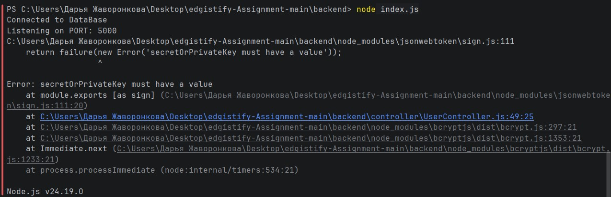

## Задание 3. Автоматизируйте получение токена. В запросе `POST /auth` скриптом во вкладке Tests сохраните токен в переменную окружения. В запросе создания бронирования сохраните `bookingid`.
Написала скрипт в запросе `POST /auth`, который сохраняет токен в переменную окружения.

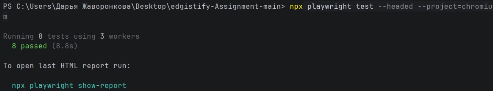

Написала скрипт в запросе `POST /booking`, который сохраняет `bookingid`.

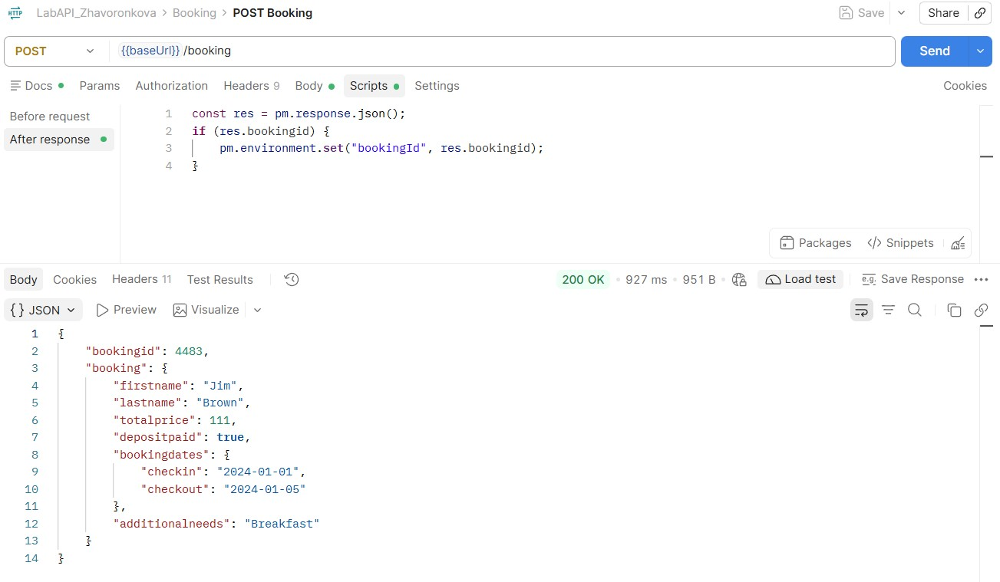

Проверила переменные окружения LabAPI_Env после выполнения скриптов.

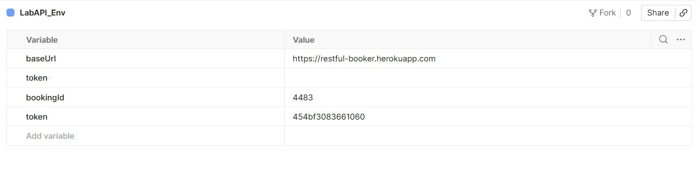

## Задание 4. Составьте и выполните тест-кейсы в каждой категории: позитивные, негативные, граничные значения.
### Таблица тест-кейсов

| ID | Категория | Метод и Путь | Входные данные (Body / Headers) | Ожидаемый результат | Фактический результат | Статус |
|---|---|---|---|---|---|---|
| TC-01 | Позитивный | `POST {{baseUrl}}/auth` | `{"username":"admin", "password":"password123"}` | 200 OK. Успешная авторизация, в ответе есть token. | Совпал с ожидаемым | **PASS** |
| TC-02 | Позитивный | `POST {{baseUrl}}/booking` | Полный валидный JSON (firstname, lastname, totalprice, depositpaid, bookingdates). | 200 OK. Создание брони, в ответе есть bookingid. | Совпал с ожидаемым | **PASS** |
| TC-03 | Позитивный | `GET {{baseUrl}}/booking/{{bookingId}}` | — | 200 OK. Получение данных созданной брони. | Совпал с ожидаемым | **PASS** |
| TC-04 | Позитивный | `PUT {{baseUrl}}/booking/{{bookingId}}` | Headers: `Cookie: token={{token}}`<br>Body: полный валидный JSON. | 200 OK. Полное обновление данных. | Совпал с ожидаемым | **PASS** |
| TC-05 | Позитивный | `PATCH {{baseUrl}}/booking/{{bookingId}}` | Headers: `Cookie: token={{token}}`<br>Body: `{"firstname": "New"}` | 200 OK. Частичное обновление (изменено только имя). | Совпал с ожидаемым | **PASS** |
| TC-06 | Позитивный | `DELETE {{baseUrl}}/booking/{{bookingId}}` | Headers: `Cookie: token={{token}}` | 201 Created. Удаление брони. | Совпал с ожидаемым | **PASS** |
| TC-07 | Позитивный | `GET {{baseUrl}}/booking/{{bookingId}}` | — (ID удаленной брони) | 404 Not Found. Ошибка, так как бронь удалена. | Совпал с ожидаемым | **PASS** |
| TC-08 | Негативный | `POST {{baseUrl}}/auth` | `{"username":"admin", "password":"wrong"}` | 401 Unauthorized. Отказ в доступе (неверный пароль). | Не совпал. Код 200 ОК. | **FAIL** |
| TC-09 | Негативный | `DELETE {{baseUrl}}/booking/1` | Без заголовка Cookie. | 403 Forbidden. Запрещено (нет токена). | Совпал с ожидаемым | **PASS** |
| TC-10 | Негативный | `DELETE {{baseUrl}}/booking/1` | Headers: `Cookie: token=invalid_token` | 403 Forbidden. Запрещено (неверный токен). | Совпал с ожидаемым | **PASS** |
| TC-11 | Негативный | `GET {{baseUrl}}/booking/999999` | — | 404 Not Found. Бронь не найдена. | Совпал с ожидаемым | **PASS** |
| TC-12 | Негативный | `POST {{baseUrl}}/booking` | `{"firstname": "Jim", (сломанный JSON)` | 400 Bad Request. Ошибка валидации JSON. | Совпал с ожидаемым | **PASS** |
| TC-13 | Негативный | `POST {{baseUrl}}/booking` | `"totalprice": "сто" (строка вместо числа).` | 400 Bad Request. Ошибка типа данных. | Не совпал. Код 200 ОК | **FAIL** |
| TC-14 | Негативный | `POST {{baseUrl}}/booking` | Только `{"firstname": "Jim"}` (нет дат). | 400 Bad Request. Ошибка отсутствия обязательных полей. | Не совпал. Код 500 Internal Server Error | **FAIL** |
| TC-15 | Граничный | `POST {{baseUrl}}/booking` | `"firstname": ""` (пустая строка). | 400 Bad Request. Ошибка валидации (поле не может быть пустым). | Не совпал. Код 200 ОК | **FAIL** |
| TC-16 | Граничный | `POST {{baseUrl}}/booking` | `"firstname": "A...A"` (1000+ символов). | 400 Bad Request. Ошибка (превышена длина строки). | Не совпал. Код 200 ОК | **FAIL** |
| TC-17 | Граничный | `POST {{baseUrl}}/booking` | `"totalprice": 0` | 400 Bad Request. Ошибка (цена не может быть 0). | Не совпал. Код 200 ОК | **FAIL** |
| TC-18 | Граничный | `POST {{baseUrl}}/booking` | `"totalprice": -100` | 400 Bad Request. Ошибка (отрицательная цена). | Не совпал. Код 200 ОК | **FAIL** |
| TC-19 | Граничный | `POST {{baseUrl}}/booking` | `"totalprice": 999999999999` | 400 Bad Request. Ошибка (слишком большое число). | Не совпал. Код 200 ОК | **FAIL** |
| TC-20 | Граничный | `POST {{baseUrl}}/booking` | `"checkin": "2024-01-10", "checkout": "2024-01-01"` | 400 Bad Request. Ошибка (дата выезда раньше даты заезда). | Не совпал. Код 200 ОК | **FAIL** |
| TC-21 | Граничный | `POST {{baseUrl}}/booking` | `"checkin": "01-01-2024"` (невалидный формат) | 400 Bad Request. Ошибка формата даты. | Не совпал. Код 200 ОК | **FAIL** |

Ниже приведены скриншоты, подтверждающие выявленные дефекты из таблицы.

**TC-08. Отсутствие проверки учетных данных**

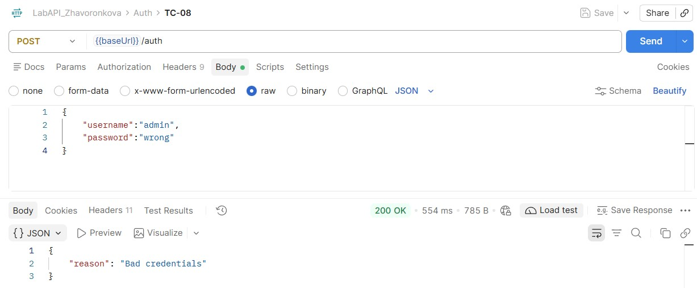

**TC-13. Отсутствие строгой типизации**

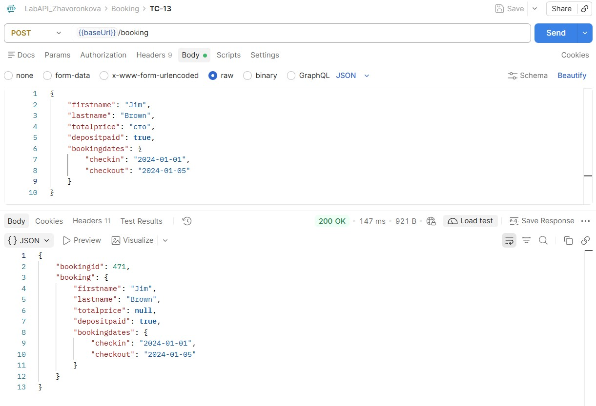

**TC-14. Необработанное исключение (500)**

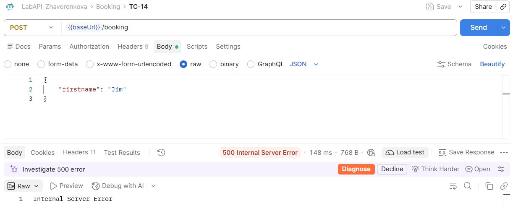

**TC-15. Отсутствие семантической валидации**

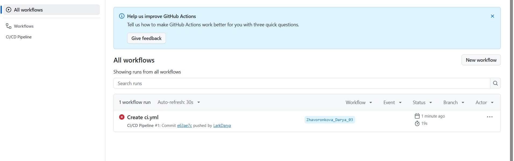


**TC-16. Игнорирование ограничений длины**

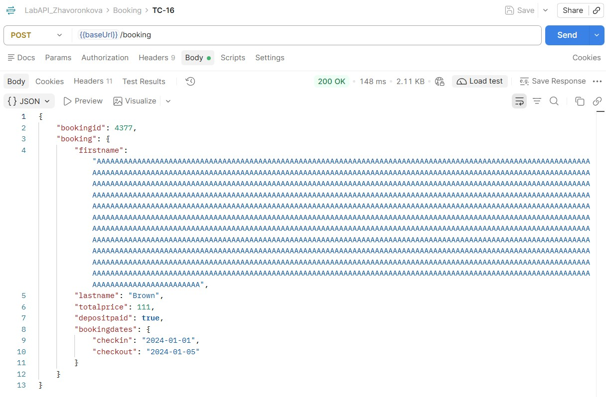

**TC-17. Нарушение бизнес-правил**


**TC-18. Отсутствие проверки диапазона значений**

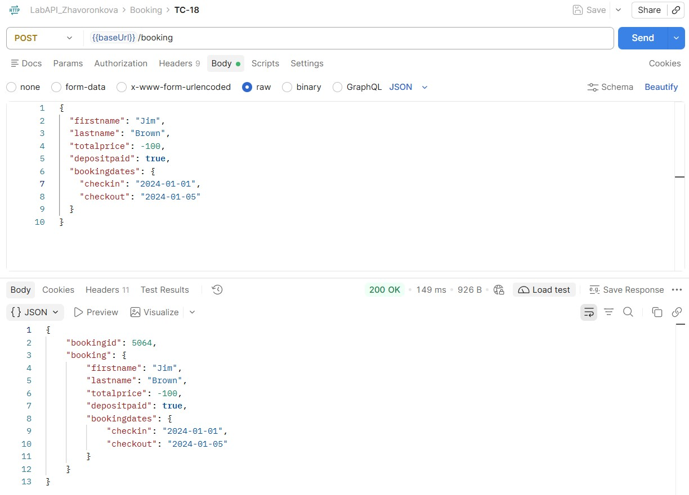

**TC-19. Отсутствие проверки переполнения**

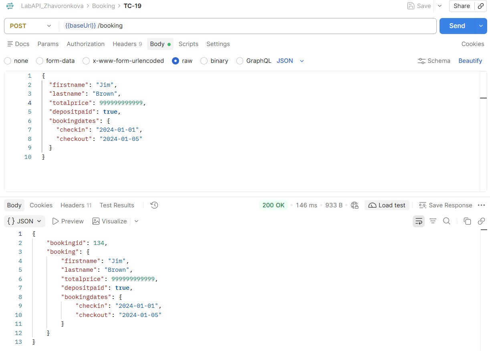

**TC-20. Нарушение логики дат**

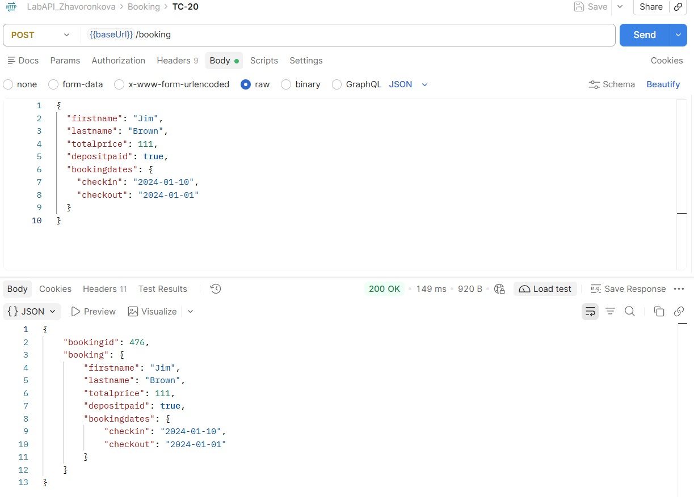

**TC-21. Отсутствие проверки формата**

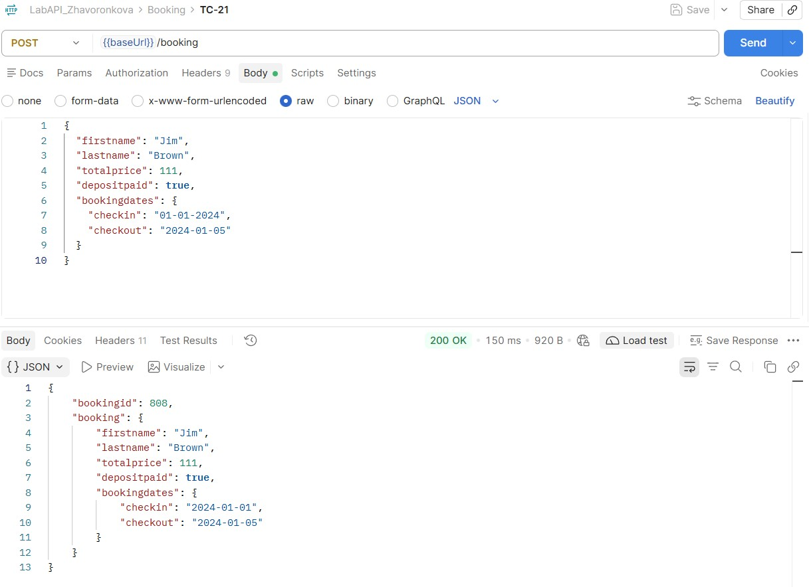


## Задание 5. Для каждого запроса добавьте во вкладку Tests минимум 3 автоматические проверки.
Для автоматической валидации ответов API во всех запросах коллекции были добавлены скрипты на вкладке **Scripts**. Скрипты разделены по типам тестов.

 **Блок 1: Для позитивных тестов (TC-01 — TC-05)**
   ```javascript
   pm.test("Статус 200", () => pm.response.to.have.status(200));
   pm.test("Время ответа < 2000 мс", () => pm.expect(pm.response.responseTime).to.be.below(2000));
   pm.test("Ответ содержит данные", () => pm.expect(pm.response.text()).to.not.be.empty);
   ```

**Блок 2: Для TC-06 (Delete) и TC-07 (Get deleted)**
   ```javascript
   // TC-06 
   pm.test("Статус 201", () => pm.response.to.have.status(201));
   pm.test("Время ответа < 2000 мс", () => pm.expect(pm.response.responseTime).to.be.below(2000));
   pm.test("Ответ содержит данные", () => pm.expect(pm.response.text()).to.not.be.empty);

   // TC-07
   pm.test("Статус 404", () => pm.response.to.have.status(404));
   pm.test("Время ответа < 2000 мс", () => pm.expect(pm.response.responseTime).to.be.below(2000));
   pm.test("Ответ содержит данные", () => pm.expect(pm.response.text()).to.not.be.empty);
   ```

**Блок 3: Для негативных и граничных тестов (TC-08 — TC-21)**
   ```javascript
   pm.test("Время ответа < 2000 мс", () => pm.expect(pm.response.responseTime).to.be.below(2000));
   pm.test("Ответ не пустой", () => pm.expect(pm.response.text()).to.not.be.empty);
   pm.test("Код ответа содержит ошибку", () => pm.expect(pm.response.code).to.be.oneOf([400, 401, 403, 404, 405, 500]));
   ```

## Задание 6. Запустите всю коллекцию через **Collection Runner** и убедитесь, что цепочка сценариев работает без ручного вмешательства (токен и `id` передаются через переменные).
Для проверки работоспособности всей цепочки сценариев без ручного вмешательства коллекция `LabAPI_Zhavoronkova` была запущена через Collection Runner с выбранным окружением `LabAPI_Env`.

По общим результатам прогона видно, что было выполнено 63 проверки за 5,68 секунд. Успешно пройдено — 54, провалено  — 9. Ошибок уровня скриптов — 0. 

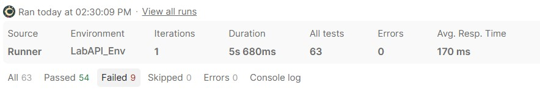

Ниже прикрепляю логи выполнения всех тестов.

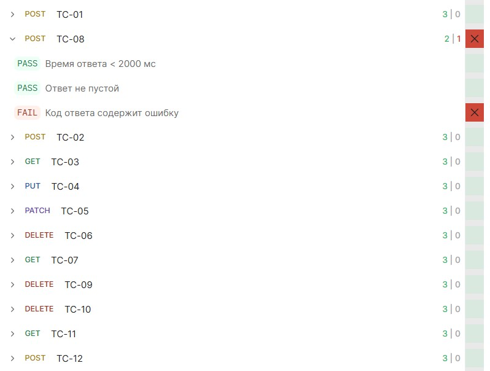
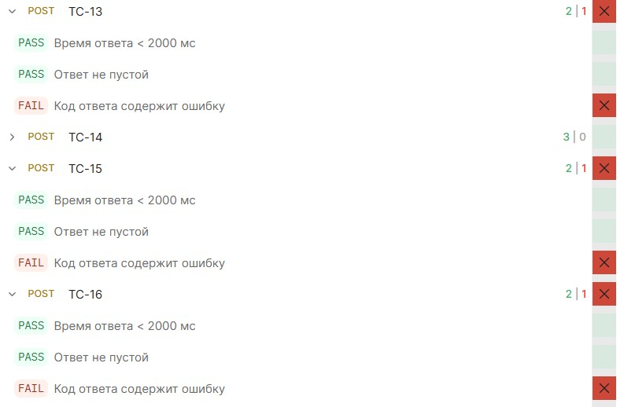
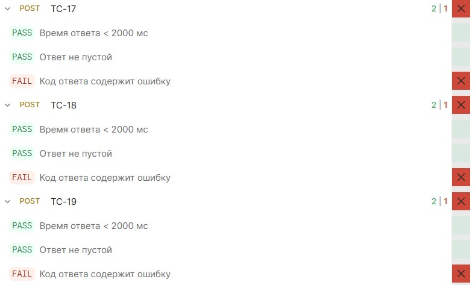
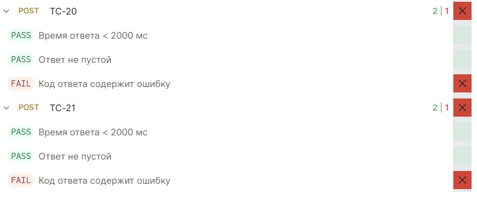

В ходе прогона коллекции через Collection Runner было подтверждено, что цепочка сценариев работает автономно. Проверки времени ответа и наличия данных пройдены, однако проверка ожидаемого кода ошибки завершилась неудачей. Это подтверждает выявленные ранее дефекты API: сервер возвращает 200 OK на некорректные данные (неверный пароль, пустые поля, отрицательные цены, неверный формат дат) вместо ожидаемых кодов. 

Переменные `token` и `bookingId` автоматически извлекаются из ответов запросов `POST /auth` и `POST /booking` с помощью скриптов и корректно подставляются в URL , что исключает необходимость ручного вмешательства.


## Задание 7. **Фактическое и ожидаемое поведение.** Это публичное учебное API, и его реальное поведение может отличаться от документации и от «правильного» REST (нестандартные коды для ошибок, код ответа для DELETE и т. д.). Оформите таблицу расхождений.
### Таблица расхождений

| № | Запрос | Ожидалось | Получено | Вывод (дефект / особенность) |
|---|---|---|---|---|
| 1 | TC-08 `POST /auth` (неверный пароль) | 401 Unauthorized | 200 OK | **Дефект.** API возвращает код успешного выполнения при неверных учетных данных, перекладывая обработку ошибки на клиент. |
| 2 | TC-13 `POST /booking` (`"totalprice": "сто"`) | 400 Bad Request | 200 OK | **Дефект.** Отсутствует валидация типов данных. Строка принимается вместо числа. |
| 3 | TC-14 `POST /booking` (без обязательных полей) | 400 Bad Request | 500 Internal Server Error | **Дефект.** Необработанное исключение сервера (падение) вместо корректной ошибки клиента. |
| 4 | TC-15 `POST /booking` (пустая строка в имени) | 400 Bad Request | 200 OK | **Дефект.** API принимает пустые значения обязательных полей. |
| 5 | TC-16 `POST /booking` (1000+ символов в имени) | 400 Bad Request | 200 OK | **Дефект.** Отсутствует валидация максимальной длины строки. |
| 6 | TC-17 `POST /booking` (`"totalprice": 0`) | 400 Bad Request | 200 OK | **Дефект.** API пропускает нулевую стоимость. |
| 7 | TC-18 `POST /booking` (`"totalprice": -100`) | 400 Bad Request | 200 OK | **Дефект.** API пропускает отрицательную стоимость. |
| 8 | TC-19 `POST /booking` (`"totalprice": 999999999999`) | 400 Bad Request | 200 OK | **Дефект.** Отсутствует ограничение на максимально допустимое число. |
| 9 | TC-20 `POST /booking` (дата выезда раньше заезда) | 400 Bad Request | 200 OK | **Дефект.** Отсутствует логическая валидация дат. |
| 10 | TC-21 `POST /booking` (невалидный формат даты) | 400 Bad Request | 200 OK | **Дефект.** Сервер принимает даты в неверном формате. |

### Список найденных дефектов (Баг-репорты)

#### 1: API возвращает токен при неверном пароле
- **Тест-кейс:** TC-08
- **Серьёзность:** High
- **Шаги воспроизведения:**
  - Отправить `POST {{baseUrl}}/auth`.
  - В теле запроса передать: `{"username": "admin", "password": "wrong"}`.
- **Ожидаемый результат:** Код `401 Unauthorized`. Отказ в авторизации.
- **Фактический результат:** Код `200 OK`. В теле ответа возвращается JSON с токеном и ошибкой `"reason": "Bad credentials"`.

#### 2: Сервер падает (500) при отсутствии обязательных полей
- **Тест-кейс:** TC-14
- **Серьёзность:** Critical
- **Шаги воспроизведения:**
  - Отправить `POST {{baseUrl}}/booking`.
  - В теле передать только `{"firstname": "Jim"}` (без дат заезда/выезда и других полей).
- **Ожидаемый результат:** Код `400 Bad Request`. Сообщение о нехватке обязательных полей.
- **Фактический результат:** Код `500 Internal Server Error`. Необработанное исключение сервера.

#### 3: Отсутствует валидация типов данных
- **Тест-кейс:** TC-13
- **Серьёзность:** Medium
- **Шаги воспроизведения:**
  - Отправить `POST {{baseUrl}}/booking`.
  - В теле передать `"totalprice": "сто"` (строка вместо числа).
- **Ожидаемый результат:** Код `400 Bad Request`. Ошибка типа данных.
- **Фактический результат:** Код `200 OK`. Бронь создается, в ответе `totalprice: null`.

#### 4: API принимает пустые значения обязательных полей
- **Тест-кейс:** TC-15
- **Серьёзность:** Medium
- **Шаги воспроизведения:**
  - Отправить `POST {{baseUrl}}/booking`.
  - В теле передать `"firstname": ""`.
- **Ожидаемый результат:** Код `400 Bad Request`. Ошибка семантической валидации.
- **Фактический результат:** Код `200 OK`. Бронь создана с пустым именем.

#### 5: Отсутствует ограничение на максимальную длину строки
- **Тест-кейс:** TC-16
- **Серьёзность:** Medium
- **Шаги воспроизведения:**
  - Отправить `POST {{baseUrl}}/booking`.
  - В теле передать строку `"firstname"` длиной 1000+ символов.
- **Ожидаемый результат:** Код `400 Bad Request`. Ошибка превышения допустимой длины поля.
- **Фактический результат:** Код `200 OK`. Строка полностью принимается сервером.

#### 6: Отсутствует валидация числовых границ (нулевая стоимость)
- **Тест-кейс:** TC-17
- **Серьёзность:** High
- **Шаги воспроизведения:**
  - Отправить `POST {{baseUrl}}/booking`.
  - В теле передать `"totalprice": 0`.
- **Ожидаемый результат:** Код `400 Bad Request`. Ошибка недопустимого значения.
- **Фактический результат:** Код `200 OK`. Бронирование успешно создается.

#### 7: Отсутствует валидация числовых границ (отрицательная стоимость)
- **Тест-кейс:** TC-18
- **Серьёзность:** High
- **Шаги воспроизведения:**
  - Отправить `POST {{baseUrl}}/booking`.
  - В теле передать `"totalprice": -100`.
- **Ожидаемый результат:** Код `400 Bad Request`. Ошибка недопустимого значения.
- **Фактический результат:** Код `200 OK`. Бронирование успешно создается.

#### 8: Отсутствует ограничение на максимальное значение числа
- **Тест-кейс:** TC-19
- **Серьёзность:** Medium
- **Шаги воспроизведения:**
  - Отправить `POST {{baseUrl}}/booking`.
  - В теле передать `"totalprice": 999999999999`.
- **Ожидаемый результат:** Код `400 Bad Request`. Ошибка переполнения (превышение лимитов).
- **Фактический результат:** Код `200 OK`. Число принимается.

#### 9: Отсутствует логическая валидация дат (checkout раньше checkin)
- **Тест-кейс:** TC-20
- **Серьёзность:** High
- **Шаги воспроизведения:**
  - Отправить `POST {{baseUrl}}/booking`.
  - В теле передать `"checkin": "2024-01-10"`, `"checkout": "2024-01-01"`.
- **Ожидаемый результат:** Код `400 Bad Request`. Ошибка временного интервала.
- **Фактический результат:** Код `200 OK`. Бронь создана.

#### 10: API принимает даты в неверном формате
- **Тест-кейс:** TC-21
- **Серьёзность:** Medium
- **Шаги воспроизведения:**
  - Отправить `POST {{baseUrl}}/booking`.
  - В теле передать `"checkin": "01-01-2024"` (формат DD-MM-YYYY).
- **Ожидаемый результат:** Код `400 Bad Request`. Ошибка формата даты (ожидается ISO 8601: YYYY-MM-DD).
- **Фактический результат:** Код `200 OK`. Запрос принимается.


**Вывод:** в ходе выполнения лабораторной работы было освоено тестирование REST API с использованием Postman. Была успешно создана коллекция с автоматическими проверками и настроена передача переменных (token и bookingId) между запросами, что позволило полностью автоматизировать сценарии без ручного вмешательства. В результате негативного и граничного тестирования были выявлены существенные дефекты на стороне сервера: API возвращает код успеха 200 OK при неверных учетных данных и полностью игнорирует валидацию типов данных, логику дат и допустимые границы значений. Также при отсутствии обязательных полей сервер падает с ошибкой 500 Internal Server Error, что подтверждает необходимость доработки механизмов обработки исключений и валидации входных данных.

