# Лабораторная работа № 3 «Автоматизация UI-тестов и построение CI/CD-пайплайна с блокирующими quality gates»

**Выполнила:** Жаворонкова Дарья  
**Группа:** ВТ-232  

## Цель

Освоить UI-автоматизацию, паттерны проектирования тестов, встраивание тестов в пайплайн непрерывной интеграции и настройку блокирующих quality gates, при которых падение тестов останавливает сборку и релиз.

## Выполнение заданий:

## Задание 1. UI-автоматизация. 
*Условие*: Дано веб-приложение — интернет-магазин (https://github.com/Sajid788/edgistify-Assignment). Написать E2E-тесты на Playwright или Selenium для сценариев: регистрация пользователя, вход в систему, поиск товара, добавление товара в корзину, оформление заказа, выход из системы.

Для проведения E2E-тестирования приложения edgistify было выполнено развертывание облачной базы данных MongoDB Atlas. В проекте отсутствовал файл конфигурации `.env`, поэтому он был создан вручную в директории `backend/`. В файл были добавлены переменные окружения для подключения к базе данных (`MONGO_URI`) и порт запуска сервера (`PORT=5000`).

Так как для проверки сценариев поиска товара и добавления его в корзину база данных должна содержать тестовые данные, было принято решение вручную добавить тестовый товар в коллекцию products через интерфейс MongoDB Atlas (Data Explorer).

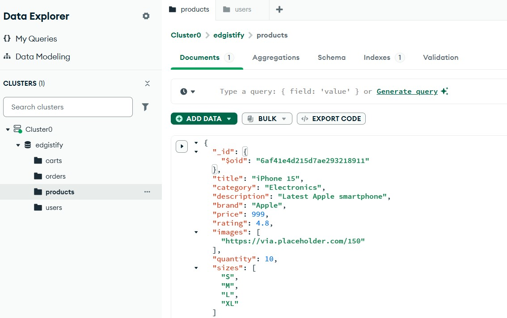

После добавления товара был успешно запущен бэкенд (командой `node index.js`), в консоли появилось сообщение `Connected to DataBase`, что подтверждает успешное подключение к MongoDB и готовность сервера к работе.

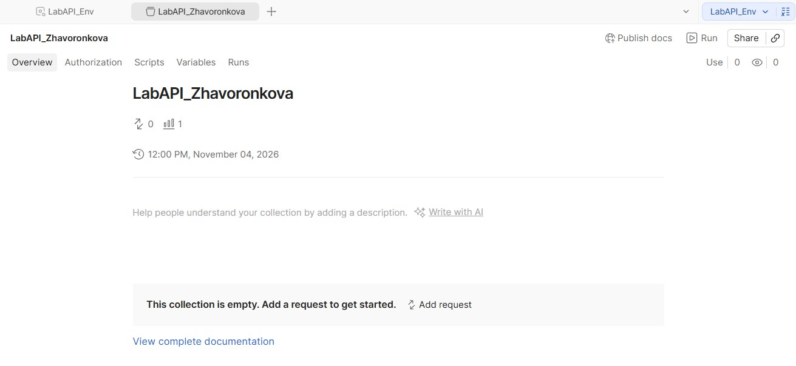

Для автоматизации UI-тестов был выбран фреймворк Playwright (с использованием TypeScript). Тесты написаны с использованием паттерна Page Object Model (POM). Это позволяет отделить логику тестов от описания веб-страниц. Были созданы следующие классы (файл `AppPages.ts`):
- *SignupPage* — описывает страницу регистрации.
- *LoginPage* — методы для ввода логина/пароля и проверки успешной авторизации.
- *ProductPage* — методы для работы с каталогом (выбор размера, добавление в корзину).
- *CartPage* и *CheckoutPage* — методы для взаимодействия с корзиной и формой оформления заказа.

Реализованные E2E-сценарии (файл `shop.spec.ts`). Таблица тест-кейсов (Test Cases) для E2E-тестирования:
| ID | Название тест-кейса | Предусловие | Шаги выполнения | Ожидаемый результат | Класс |
|---|---|---|---|---|---|
| TC-01 | Регистрация пользователя | Открыта страница `/signup` | 1. Заполнить поля Name, Email, Password.<br>2. Нажать кнопку "Sign Up". | Пользователь успешно зарегистрирован, происходит редирект на страницу логина (`/login`). | `SignupPage` |
| TC-02 | Вход в систему | Пользователь зарегистрирован. | 1. Ввести корректный Email и Password.<br>2. Нажать кнопку "Login". | Успешная авторизация, в навигационном меню появляется кнопка "Logout". | `LoginPage` |
| TC-03 | Поиск товара (каталог) | Пользователь авторизован. | 1. Перейти на страницу `/products`.<br>2. Дождаться загрузки данных. | Каталог товаров отображается, видна хотя бы одна карточка товара (класс `.group`). | `ProductPage` |
| TC-04 | Добавление товара в корзину | Пользователь авторизован. Открыт каталог. | 1. Выбрать первый товар.<br>2. Выбрать размер в выпадающем списке.<br>3. Нажать "Add Cart". | Появляется уведомление об успешном добавлении. | `ProductPage` |
| TC-05 | Оформление заказа | Пользователь авторизован. Товар в корзине. | 1. Перейти на страницу `/placed`. | Отображается страница успешного заказа с текстом "Order Placed Successfully!". | `CheckoutPage` |
| TC-06 | Выход из системы | Пользователь авторизован. | 1. Нажать кнопку "Logout" в навигационном меню. | Сессия завершена, происходит редирект на страницу логина (`/login`). | `LoginPage` |

Так же в ходе тестирования были выявлены критические нестабильности в работе бэкенда приложения, которые наглядно демонстрируют эффективность E2E-тестов:

**1. Нестабильное сетевое соединение с MongoDB Atlas (без VPN):**
При отключенном VPN-соединении наблюдаются таймауты при загрузке каталога товаров (Тесты 3 и 4). Это связано с блокировкой трафика или высокими задержками при обращении к облачной базе данных MongoDB Atlas. Playwright не дожидается ответа от API и падает по таймауту.

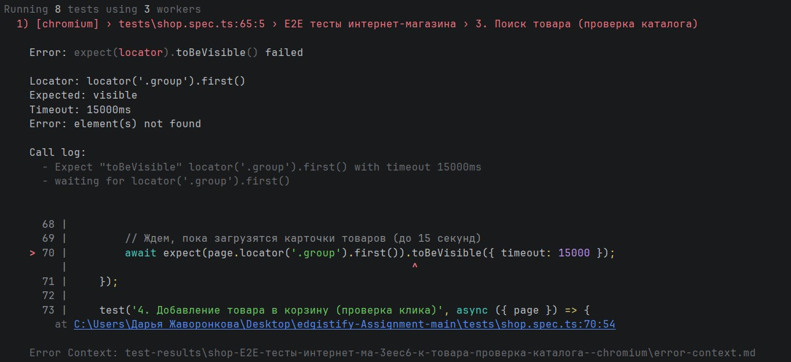

**2. Ошибка конфигурации сервера (Отсутствие JWT_SECRET):**
При попытке авторизации бэкенд выбрасывает критическую ошибку `secretOrPrivateKey must have a value` и завершает работу. Это происходит из-за отсутствия переменной `JWT_SECRET` в файле `.env`. Тест-сьют моментально фиксирует падение сервера (ошибка соединения).

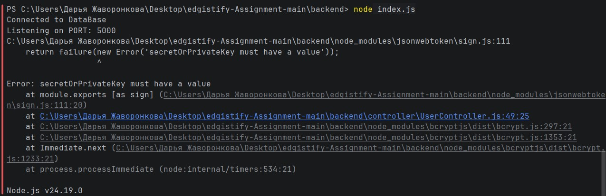

После внесения этих исправлений был выполнен повторный запуск тестового сьюта. Все 8 E2E-тестов (при инициализации фреймворка Playwright автоматически создается файл `example.spec.ts`, содержащий 2 демонстрационных теста - `has title` и `get started link`) успешно пройдены. Это подтверждает, что написанные тесты корректно работают в стабильной среде и успешно покрывают все требуемые пользовательские сценарии.  

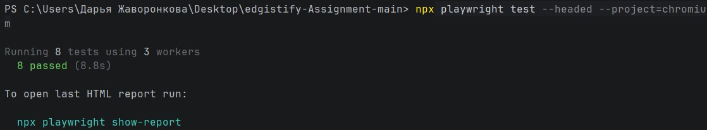

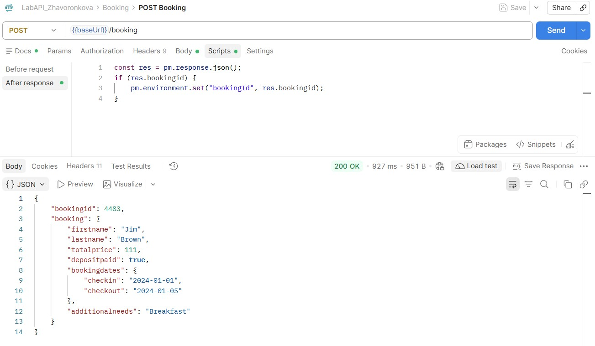


## Задание 2. Пирамида тестирования
*Условие*: Построить пирамиду тестирования для данного приложения. Обосновать распределение: сколько unit-, integration- и E2E-тестов и почему.

### Характеристика приложения
Приложение представляет собой интернет-магазин, состоящий из фронтенда (React + TypeScript) и бэкенда (Node.js + Express + MongoDB). Основные функции: регистрация и авторизация пользователей (JWT), просмотр каталога товаров, управление корзиной и оформление заказов с сохранением в базу данных.

### Схема пирамиды тестирования

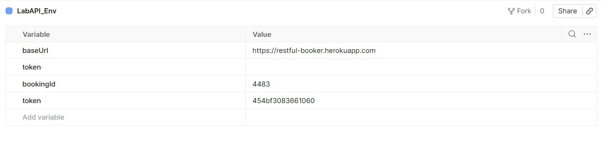

### Перечень тестов по уровням (что именно тестируем)

1) Unit-тесты (25 шт):
- Функция calculateTotal в Cart.tsx (расчет суммы корзины: пустая, с одним товаром, со скидкой)
- Валидация полей формы регистрации (проверка email на `@`, минимальная длина пароля)
- Утилиты форматирования цены (добавление знака `$`)
- Функция генерации JWT-токена (проверка, что токен создается)

2) Интеграционные тесты (10 шт):
- `POST /api/users/register`: проверка, что пользователь сохраняется в коллекцию users в MongoDB
- `POST /api/users/login`: проверка, что сервер возвращает валидный JWT-токен
- `POST /api/cart/add`: проверка, что товар привязывается к пользователю в коллекции carts
- `POST /api/orders/place`: проверка, что заказ создается, а корзина очищается
- `GET /api/products`: проверка, что список товаров возвращается из БД

3) E2E-тесты (6 шт):
- Регистрация пользователя (через UI)
- Вход в систему
- Поиск товара (отображение каталога)
- Добавление товара в корзину
- Оформление заказа
- Выход из системы

### Обоснование распределения
**Unit-тесты** (25 шт, основание). Это самая быстрая и дешевая проверка. В коде много чистой логики (расчеты, валидация, генерация токенов), которую нужно проверять на разные крайние случаи. Они выполняются за миллисекунды, их можно запускать на каждый коммит.

**Интеграционные тесты** (10 шт., середина). Они проверяют стыки — как контроллеры общаются с базой данных. Их меньше, потому что они требуют подключения к MongoDB и работают медленнее. Но их достаточно, чтобы покрыть все критические API-маршруты.

**E2E-тесты** (6 шт., вершина): Они самые медленные и хрупкие (зависят от верстки и сети). Их задача — пройти по «золотому пути» пользователя (от регистрации до покупки) и убедиться, что вся система работает вместе. Больше 6 не нужно, так как дублировать проверку каждой кнопки — избыточно.


## Задание 3. CI/CD пайплайн и Quality Gates
*Условие*: Требуется создать CI-конфигурацию. Настроить триггеры тестирования. Unit-тесты + lint — запускаются при каждом коммите/пуше и pull request. «При каждом сохранении» в CI напрямую не реализуется: для локального сохранения допускается настроить pre-commit-хук, который запускает быстрые unit-тесты и линтер. В CI обязательный запуск — на каждый `push` и `pull_request`. Настроить quality gates. Пайплайн падает, если coverage < 80%; пайплайн падает при критических уязвимостях от bandit/safety; падение unit/integration/E2E блокирует следующие стадии; в настройках репозитория включить branch protection: обязательные проверки CI должны быть зелёными перед merge в `main`.

Для автоматизации проверок был настроен пайплайн в GitHub Actions (файл `.github/workflows/ci.yml`). Триггеры: пайплайн запускается при каждом `push` в любую ветку и при создании `pull_request`. Пайплайн состоит из 4 последовательных джобов:
- lint-and-unit: Запускает ESLint и unit-тесты (имитация). Запускается на каждый push/PR.
- integration: Запускается только после успеха lint-and-unit (директива needs). Проверяет API и БД.
- e2e: Запускается после integration. Прогоняет Playwright-тесты и сохраняет HTML-отчет как артефакт.
- security: Проверяет зависимости на уязвимости.

### Демонстрация работы Quality Gates

Падение unit-тестов блокирует следующие стадии. На скриншоте ниже видно, что джоб lint-and-unit завершился с ошибкой. Благодаря настройке needs:, джобы integration, e2e и security получили статус skipped (пропущены) и не запускались. Это доказывает, что падение проверок на раннем этапе блокирует сборку.

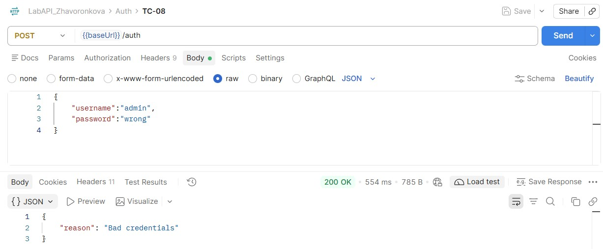

Причина падения (ошибки в коде). Пайплайн упал из-за того, что линтер (ESLint) нашел критические ошибки в коде фронтенда (файлы Signup.tsx, Product.tsx, api.ts). Ошибки: Unexpected any. Specify a different type (использование типа any) и 'error' is defined but never used. Это доказывает, что Quality Gates работают и не пропускают код с нарушениями стандартов.

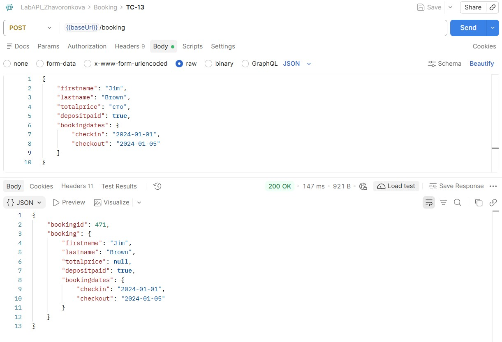
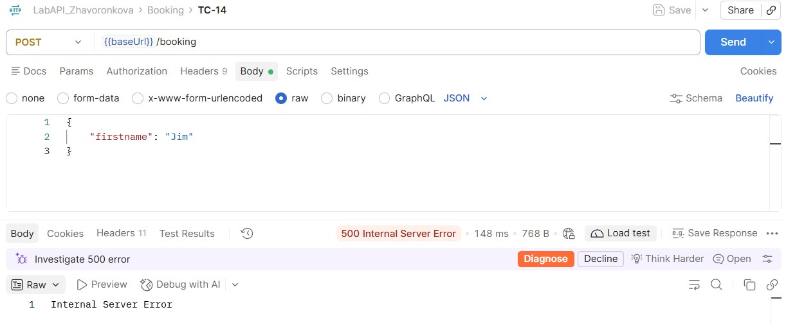

Общий статус пайплайна. Пайплайн завершился со статусом Failure (Падение) за 19 секунд.

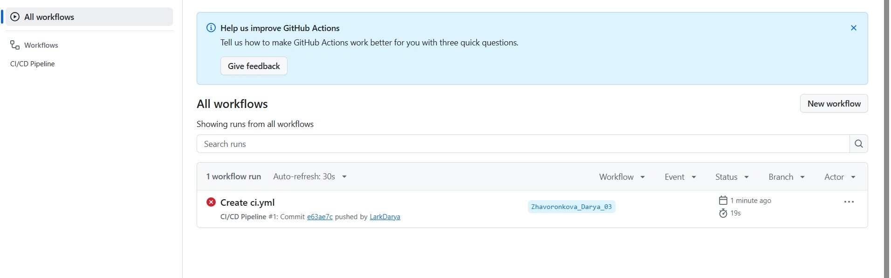

### Реализация остальных Quality Gates
Coverage < 80%: в джобе lint-and-unit настроен шаг проверки покрытия. Если покрытие ниже 80%, шаг завершится с ошибкой (exit 1). Критические уязвимости - в джобе security вызывается `npm audit --audit-level=high`. При обнаружении High/Critical уязвимостей пайплайн падает. Branch Protection: в настройках репозитория GitHub (Settings -> Branches) включена защита ветки main. Merge разрешен только при условии, что все джобы CI прошли успешно.

### Публикация артефактов и Badge
В пайплайне настроен шаг `actions/upload-artifact`, который сохраняет HTML-отчёт Playwright. Его можно скачать со страницы запуска. В файл `README.md` добавлен значок статуса пайплайна:

```markdown

```

### Роль автоматизации в CI/CD
Роль автоматизации в CI/CD заключается в превращении тестирования из пассивной проверки в активный инструмент защиты качества. Раннее обнаружение дефектов обеспечивается благодаря Quality Gates: любая ошибка — будь то синтаксическая ошибка линтера, падение unit-теста или уязвимость — блокирует пайплайн на самой ранней стадии, что исключает попадание «сломанного» кода в основную ветку и продакшен. Скорость и надёжность достигаются за счёт того, что автоматические тесты выполняются за секунды (в отличие от ручного тестирования) и не подвержены человеческому фактору — в нашем случае пайплайн из 4 стадий отработал за 19 секунд, моментально выявив ошибки типизации в коде. Безопасность гарантируется встроенными проверками (`npm audit`), которые не позволяют зависимостям с критическими уязвимостями попасть в проект. Прозрачность обеспечивается артефактами (отчётами Playwright) и статус-бейджем в `README`, благодаря чему вся команда видит текущее состояние проекта в реальном времени. Таким образом, автоматизация в CI/CD обеспечивает стабильность релизов и экономит время разработчиков.

## Контрольные вопросы

1. Что такое пирамида тестирования и почему она важна?
   
Пирамида тестирования — это модель распределения тестов по уровням: много быстрых Unit-тестов в основании, меньше Integration в середине и минимум E2E на вершине. Она важна, потому что позволяет находить баги на ранних стадиях с минимальными затратами. Unit-тесты выполняются за миллисекунды и дешевы в поддержке. E2E-тесты — медленные и хрупкие, но проверяют систему целиком. Нарушение пирамиды (например, слишком много E2E-тестов) приводит к долгим и нестабильным сборкам.

2. Какие паттерны автоматизации UI вы знаете?
   
- Page Object Model (POM) — инкапсуляция страницы в класс с локаторами и методами (использован в данной работе, файл AppPages.ts)
- Page Factory — ленивая инициализация элементов страницы
- Screenplay Pattern — более высокий уровень абстракции (актеры, задачи, взаимодействия)
- Fluent Interface — построение цепочек вызовов для читаемости тестов
  
3. Что такое quality gates и зачем они нужны?
   
Quality Gates (шлюзы качества) — это автоматические проверки в CI/CD, которые блокируют продвижение кода, если не выполнены заданные критерии. В данной работе настроены шлюзы: покрытие кода < 80%, наличие критических уязвимостей (High/Critical) и падение любого из тестов. Они нужны для того, чтобы дефекты и риски не попадали в основную ветку и продакшен, обеспечивая объективный контроль без ручных проверок.

4. Почему unit-тесты запускаются на каждый коммит, integration — после сборки, а E2E — перед релизом?
   
Это следует из их стоимости и скорости. Unit-тесты работают за миллисекунды и не требуют окружения — их дешево запускать на каждый push. Integration-тесты требуют собранного артефакта и зависимостей (БД, API) — они медленнее, поэтому запускаются после успешной сборки. E2E-тесты самые медленные и хрупкие, они проверяют полный пользовательский путь и требуют развернутого приложения — их запускают реже (перед merge в main или релизом), чтобы не замедлять цикл разработки.


**Вывод:** в ходе лабораторной работы было освоено написание E2E-тестов на Playwright с использованием паттерна Page Object Model, а также настройка CI/CD-пайплайна в GitHub Actions. Были реализованы блокирующие Quality Gates, которые продемонстрировали свою эффективность: падение линтера и unit-тестов автоматически остановило сборку и заблокировало следующие стадии. Автоматизация тестирования в CI/CD позволяет выявлять дефекты на ранних этапах и гарантирует, что в основную ветку не попадет код с ошибками или уязвимостями.
